<!-- SPDX-License-Identifier: CC-BY-SA-4.0 -->

# Design Assessment of the ridrs App (2026-11-14)

What the app looks like today, where its look comes from in the code, and why it does not yet read as one product. It is the basis for the five redesign concepts in [`../concepts/`](../concepts/README.md).

**How it was made.** The Mac app ran from this worktree (`pnpm --filter @ridrs/native tauri dev`, main at `241b90b`), driven through the debug bridge (`pnpm debug:app eval`, `screenshot`, `layout`, `a11y`). Every screenshot below is the native `WKWebView` snapshot of the running app, scaled down to 1600 px. The desktop window was 1549 x 786 pt (the "wide" breakpoint). The **medium (900 pt) and compact (420 pt) shots are simulated**: the window could not be resized from the bridge, so the main screen's breakpoint state was set to `medium`/`compact` through React and `#ridrs` was narrowed to that width. These shots show the real CSS of those breakpoints. Effects that depend on the real viewport (`vw`/`vh`, media queries on width) can differ. Drags were simulated with synthetic `DragEvent`s carrying the app's typed `DataTransfer` payloads. Focus rings were made visible by copying every `:focus-visible` rule onto an attribute, because the window was in the background. The style inventory comes from a script over all `.ts`, `.tsx` and `.css` files in `apps/native/src`, `packages` and `plugins` (tests, i18n and node_modules excluded).

Not seen live: the workout player in a ride with a workout (the ERG/target power widgets with real data), a ride with devices connected, the ride recovery prompt ("continue an interrupted ride"), the companion app on Android, the light theme (the app has none, see section 4.7), the file-drop overlay, the workout import and export dialogs, and the device setup detail pages.

---

## 1. The short version

The app has **three visual languages and a fourth half-language**, and they meet in the main menu:

| Language | Where | Shape | Type | Colour | Motion |
|---|---|---|---|---|---|
| **"Kinetic race"** (angular, loud) | calendar entries, the menu's current entry, filled next-ride slots, the "today" column | `clip-path` chamfers of 12 px / 8 px, `border-radius: 0` | Chakra Petch italic capitals, JetBrains Mono labels | solid volt `#ccff00` fills with neon glows, cyan bars with glow | glow sweeps and pulses |
| **"Media gallery"** (soft, rounded) | route, video and teaser cards, chips, pills, back button over pictures | 12 px radius (the token), 999 px pills, 50 % circles, blurred glass | Plus Jakarta Sans, solid; titles capitals via a class-name match | photos under dark gradients, white text, volt profile line | 0.4 s zoom on hover |
| **"Native default"** (unstyled) | the ride itself: Pause, Resume, Finish ride, the HUD tiles | browser buttons, 10–14 px radius | system font sizes in inline styles, weight 700 | light grey OS buttons, `rgba(16,20,24,.72)` tiles, no tokens | none |
| **Pre-Kinetic leftovers** (half-language) | briefing, debriefing, devices, training plan, workout details/editor, garage | 16 px / 8 px radii, 1.5 px borders | system-ui at 800 that silently drops to 500–600 | an older cyan `#27c8ff` and lime `#8dff2a` as fallbacks and constants | spinners |

The mixes the maintainer feels are real and measurable. **16 distinct `border-radius` values** in CSS plus 12 more in inline styles, and on top of them a fourth shape (the chamfer) drawn with `clip-path`. **23 font sizes**, **5 requested weights where only 2–3 exist**, **130 distinct raw colours** beside the tokens, and **three different fallback values for most tokens**. The workouts look aggressive because they are the only place where the brand's race grammar (chamfer, solid neon, glow, italic capitals) is used at full strength, while the rides use the generic card grammar of `@ridrs/ui-preview`.

The trash at the bottom of the menu feels half-done because it is **a fourth entry type** in a menu that already has three. It has its own size, its own layout (icon over label), a badge drawn with an undefined token, a red dashed outline with no fill as its "ready" state, a wine-coloured hint that floats over the page and is cut off on phones, no drop feedback, and wording that says "delete" for a reversible move.

---

## 2. Screen by screen

### 2.1 Today (main screen)

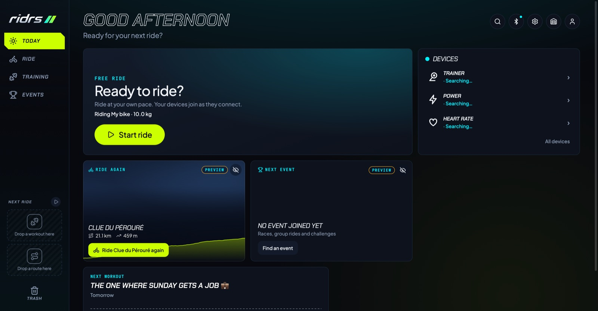

- **Works:** a clear hierarchy (greeting, hero, devices, tiles). The volt "Start ride" is unmistakable from across a room. The outlined greeting is a strong brand moment, and it is used once per page as ADR 0074 asks.
- **Mixes:** the hero tile is rounded (12 px) with a cyan glow; "Ride again" is a picture card with pill buttons and circular glass icon buttons; "Next workout" uses the training-plan theme (16 px radius fallback, old palette), a dashed FTP line and a hard-edged zone chart. The Devices tile uses italic capitals for device names ("TRAINER") but sentence case for the status, and puts a bullet "·" before "Searching…".
- **Labels:** "FREE RIDE", "RIDE AGAIN", "NEXT WORKOUT" are JetBrains Mono in cyan with 0.12 em tracking. "PREVIEW" badges are amber outlined pills in a third style. One card carries three label styles (classifier, PREVIEW badge, hide icon).
- **The menu column:** see section 3 for the next ride and the trash.

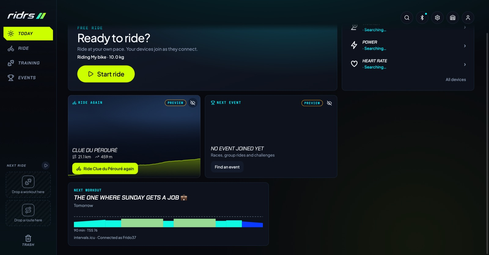

### 2.2 Ride (routes and videos)

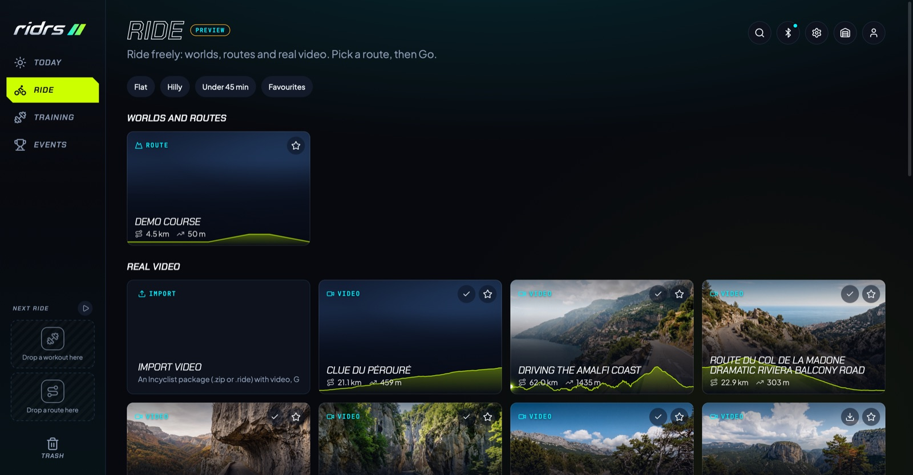

- **Works:** the picture cards are the most polished element of the app. They have a 16:10 grid with exact row sizing, a scrim that keeps titles legible, an elevation profile along the bottom edge and glass tool buttons.
- **Mixes:** card titles are Chakra Petch italic capitals at weight 400 (ADR 0074's "thinner card titles") on a soft, photographic card. That is the right instinct but a half-step: the card shape (12 px round, glass) speaks "lifestyle", the title speaks "race". Cards without a picture (Demo Course, Clue du Pérouré) show a flat navy gradient that looks like a loading state. Classifier labels ("VIDEO") turn white with a text shadow over pictures and cyan elsewhere. The amber "PREVIEW" pill next to the outlined page title is a third type style in the head.
- **Chips** (Flat, Hilly, …) are 999 px pills with `filter: brightness(1.2)` as their hover. When selected they turn cyan with dark text.

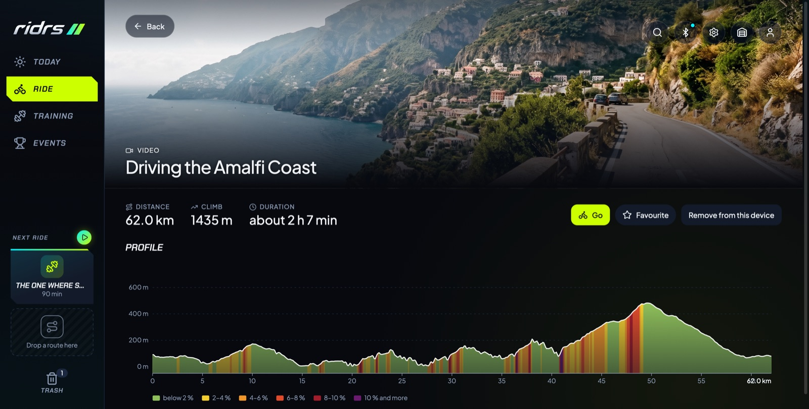

- **Route details:** the hero title is solid Plus Jakarta Sans 500 in sentence case ("Driving the Amalfi Coast"), the stats labels are small capitals in a fourth style, and the profile uses a grade palette (green → yellow → orange → red → wine → purple, `plugins/ui-route-profile/client/profile-data.ts:15-20`) that has nothing to do with the power-zone palette or the brand colours. The "Back" glass pill and the circular top-bar actions over the picture are well done.

### 2.3 Events

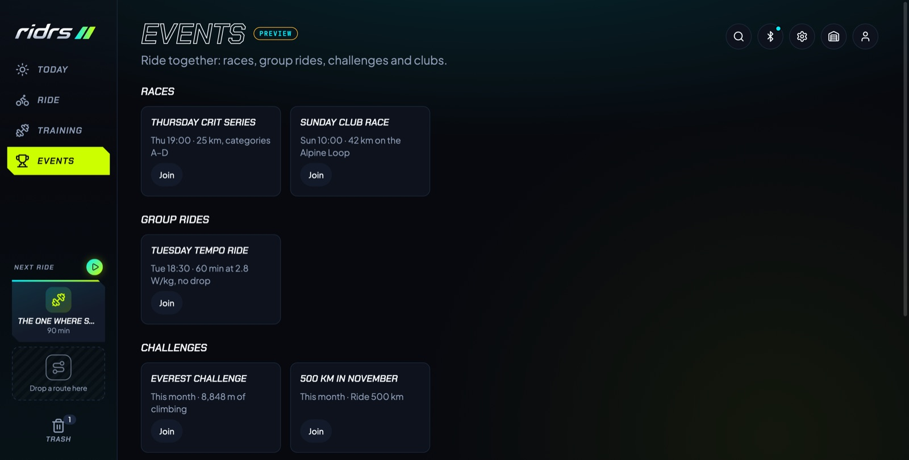

Plain `pv-card`s (16 px radius fallback, 1 px line) with italic capital titles and grey "Join" buttons. It is consistent with itself but has no imagery or accent: it reads as a wireframe beside Ride.

### 2.4 Training: calendar, library, details, editor

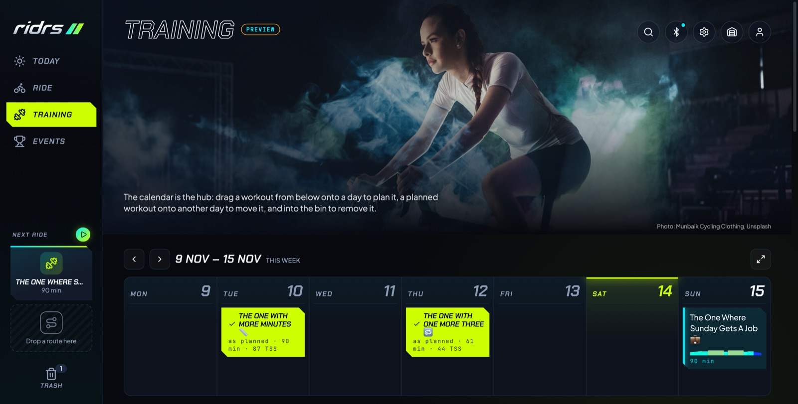

- **The calendar is the most "aggressive" screen.** Done entries are **solid volt blocks with chamfered corners and a volt glow** (`week.tsx:448`), the today column has a volt top bar with an 18 px glow, and planned entries have a cyan 4 px bar with a 12 px cyan glow (`week.tsx:439`). In a 7-day grid that gives up to seven glowing neon objects at once.
- **Mixed type inside one entry list:** done entries use italic capitals plus a mono "as planned · 90 min · 87 TSS" that wraps mid-phrase ("90 / min"). The planned entry for Sunday uses sentence case Plus Jakarta Sans ("The One Where Sunday Gets A Job"), because it has a different class (`tr-entry`) that the Kinetic font layer does not catch.
- **The mono label wraps** because JetBrains Mono at 0.12 em tracking is ~35 % wider than the text face.

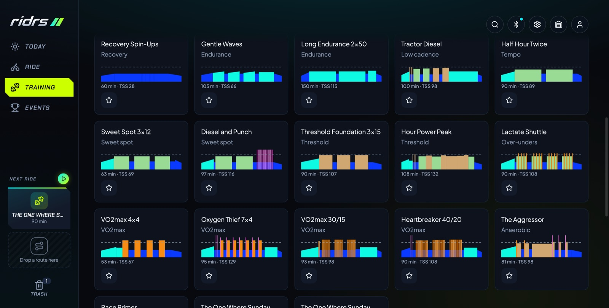

- **The library is rounded** (`pv-card`, 16 px fallback / 12 px token), with sentence-case titles in Plus Jakarta Sans 400. So the *same workout* is a chamfered italic capital block in the calendar and a soft rounded card in the library, one scroll apart.
- **Zone colours:** a ten-step ramp (`plugins/ui-workout-chart/client/palette.ts:9-20`) of saturated blue, steel, cyan, mint, yellow, tan, orange, pink-red, magenta, violet. It is colour-blind checked, which is good, but hue jumps (mint → tan → orange) make neighbouring zones look unrelated. The bars have hard corners, so a chart is a row of sharp rectangles: the second source of "aggressive".

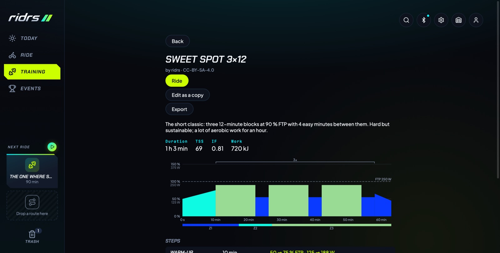

- **Workout details looks unfinished:** "Ride", "Edit as a copy" and "Export" are stacked vertically as three separate pill buttons of different widths. "Back" is a plain pill, unlike the glass back button with an arrow on route details. The stats ("Duration TSS IF Work") use cyan mono labels with values below.

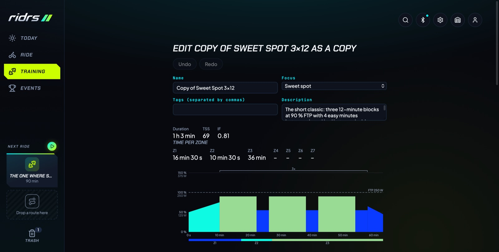
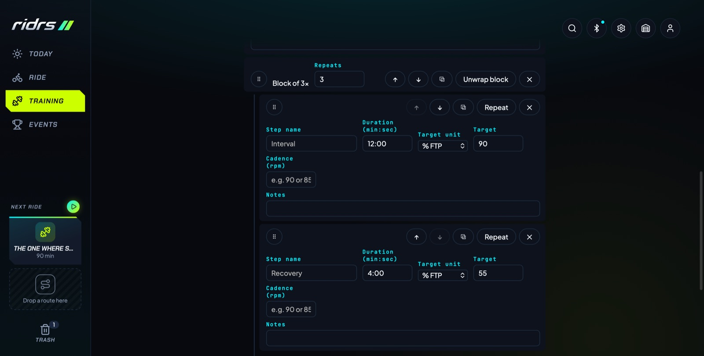

- **Editor:** the title reads **"EDIT COPY OF SWEET SPOT 3×12 AS A COPY"**. That is a text bug: "Edit … as a copy" wraps a name that already starts with "Copy of". Field labels are cyan mono ("Name", "Focus", "Tags (separated by commas)") through the `-label` class match, which makes a long label like the tags hint read like code. Inputs have 8 px radius and 1.5 px borders (`ui-workout-editor/client/theme.tsx:15,23`), the steps list 6 px. Undo/Redo are grey pills.

### 2.5 Dialogs: devices, garage, me, search, settings

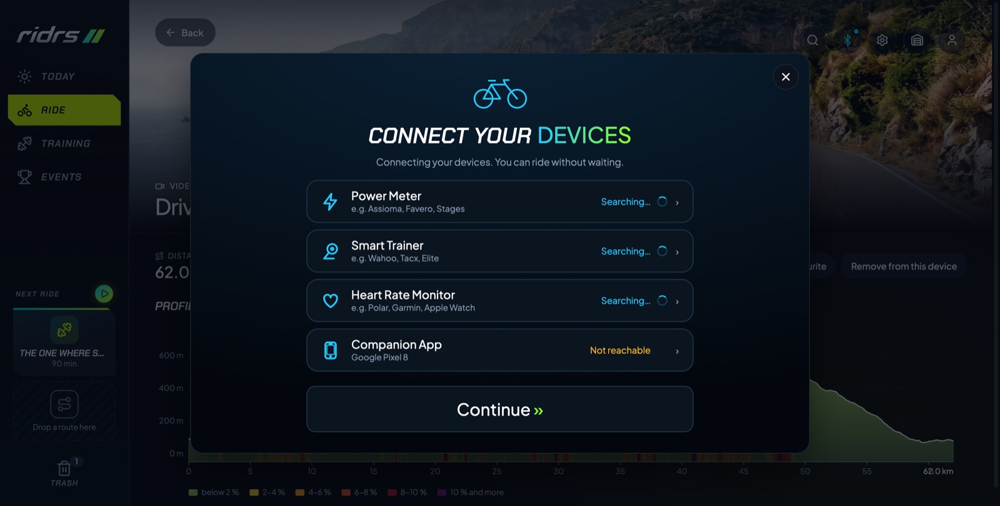

- **Devices** is its own world: a centred cyan line-art bicycle, a **two-tone headline "CONNECT YOUR DEVICES"** (white plus cyan), rows with 12 px radius and a cyan 1 px border, spinner rings, an amber "Not reachable", and a huge "Continue »" button whose chevrons are lime `#8dff2a` from the old palette (`ui-devices/client/theme.tsx:26-34`). 49 inline `style={{…}}` blocks in `ui-devices/client/setup.tsx` alone.

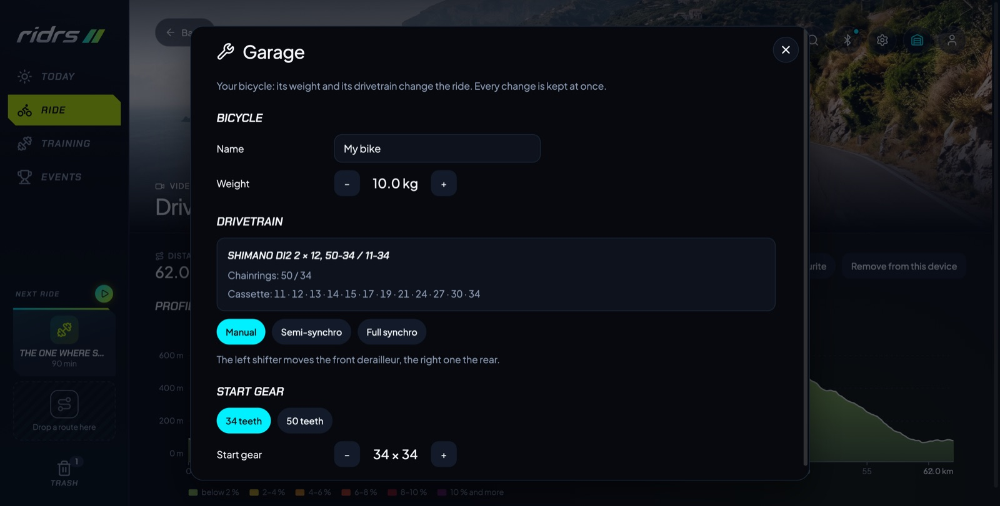
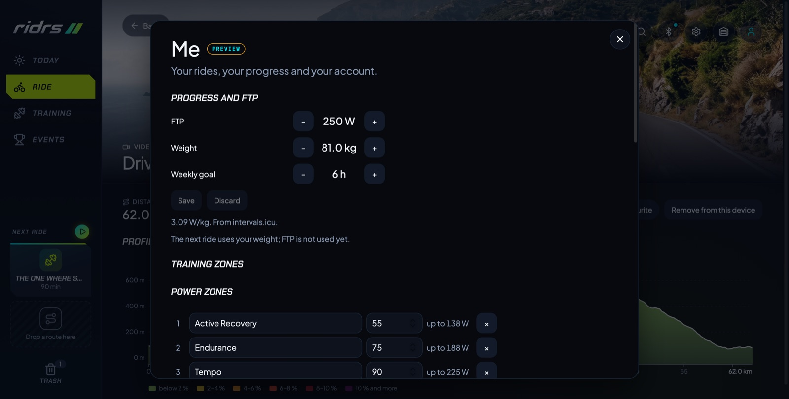
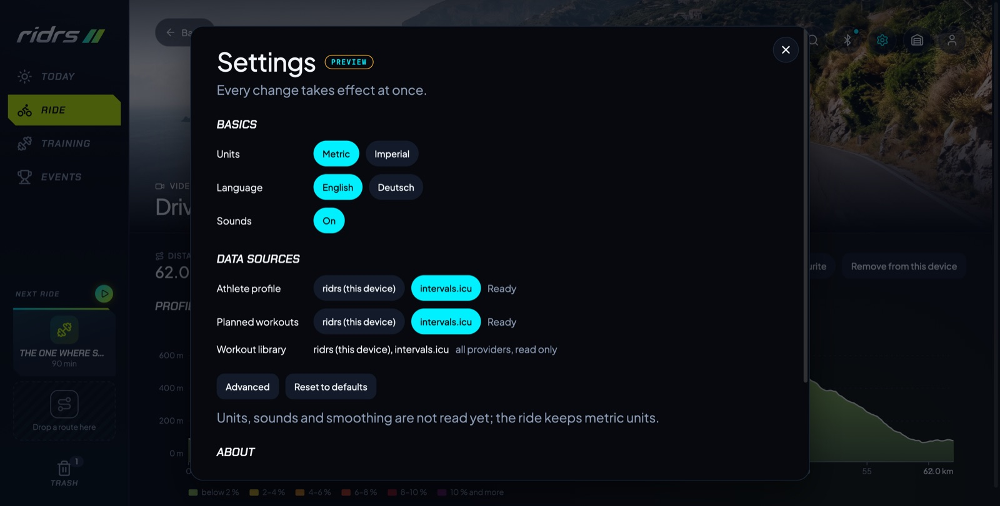
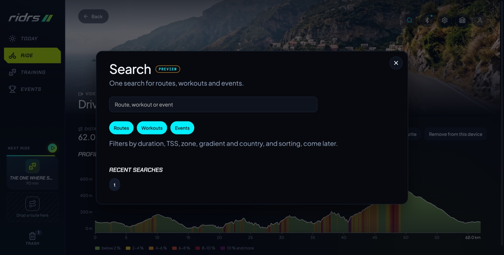

- **Garage, Me, Settings:** dialog titles are solid sentence case ("Garage", "Me", "Settings") as ADR 0074 decided for dialogs, while section heads inside are italic capitals. The steppers (− / +) are small dark squares with 8 px radius. Settings chips are cyan when selected. "Advanced" and "Reset to defaults" are grey pills with the same weight as the chips.
- **Dialog frame:** 20 px radius (`ui-main-screen/client/index.tsx:105`), the only 20 px in the app, with a circular close button. It is the only real elevation shadow in the app (`0 24px 64px`).

### 2.6 Briefing

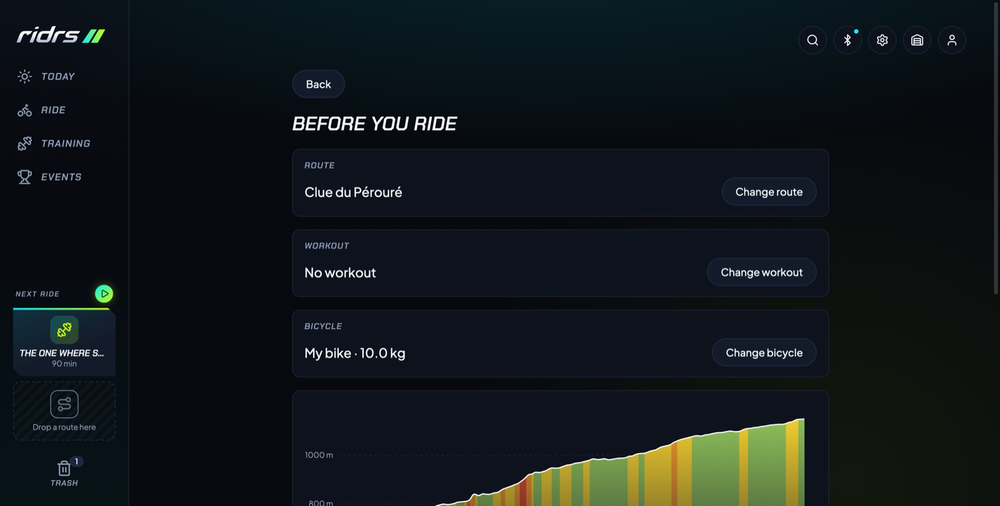
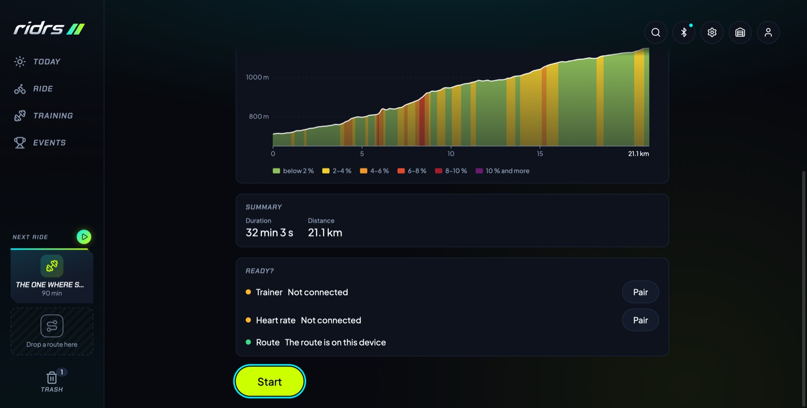

- **Works:** a clear list (route, workout, bicycle, profile, summary, ready check, Start). Each block is a 16 px fallback card with a small capital heading. The Start button is volt and large. The focus ring (3 px cyan, 2 px offset) is clearly visible on it.
- **Mixes:** the briefing's own theme (`plugins/ui-briefing/client/theme.tsx`) predates Kinetic. The title "BEFORE YOU RIDE" is italic capitals but `.br-title` asks for 800, which does not exist. The status dots are green/amber circles. The grade-coloured profile is the third chart palette on the ride path (grade, zones, HUD). The Start button sits left-aligned at the bottom, below the fold, while the hero on Today centres attention.

### 2.7 In the ride: HUD, pause

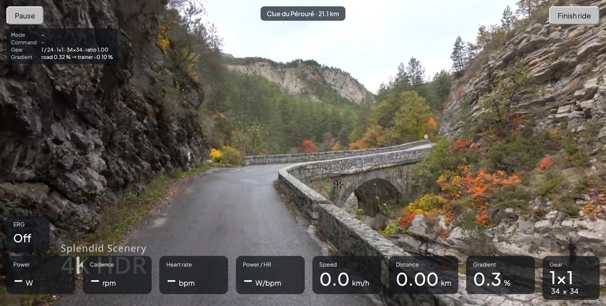

- **The ride does not look like ridrs.** "Pause", "Resume" and "Finish ride" are **unstyled browser buttons** (light grey, OS shadow). Only `fontSize`, `padding` and `borderRadius: 10` are set (`plugins/ui-activity-screen/client/index.tsx:21`). The metric tiles are inline-styled `rgba(16,20,24,.72)` boxes with radius 14 and values at 44 px/700 (`ui-widget-power/client/index.tsx:21-36`, the same in every widget). The route pill at the top centre is a fourth style. "Paused" is plain white text at 48 px in the middle of the video.
- **A debug panel** (Mode, Command, Gear, Gradient) sits in the top left during a normal ride.
- **Readability at distance:** the values are large, but units are 18 px and labels 14 px at 80 % opacity, which is hard to read from 2 m. **No tabular figures**: `font-variant-numeric` is used in 3 files in the whole repository, none of them a HUD widget, so digits jitter as values change. The gear tile is taller than the rest of the row. The ERG tile stands alone above the row.
- **No brand:** no volt, no cyan, no Chakra Petch. The Kinetic font layer does reach the tiles (Plus Jakarta Sans), so the HUD is in the text face at a weight that is not loaded.

### 2.8 Debriefing

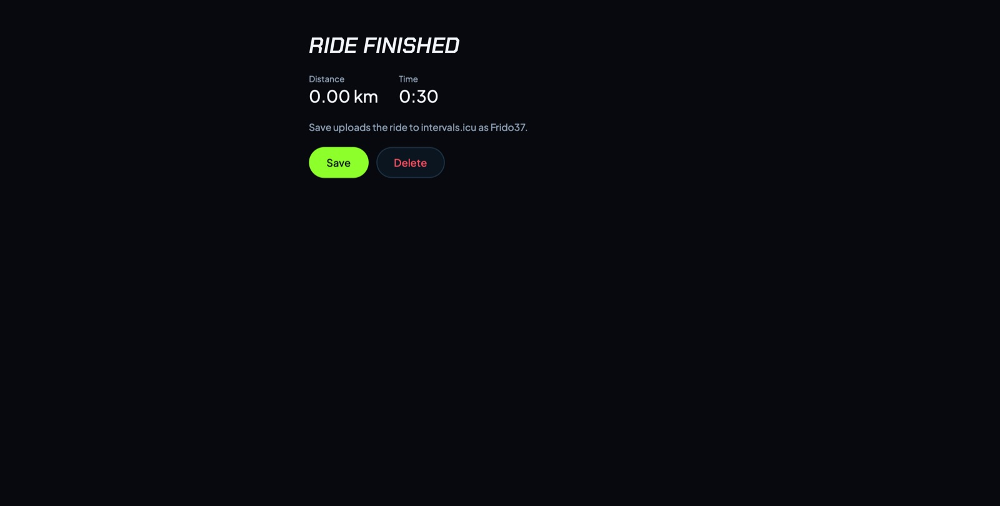
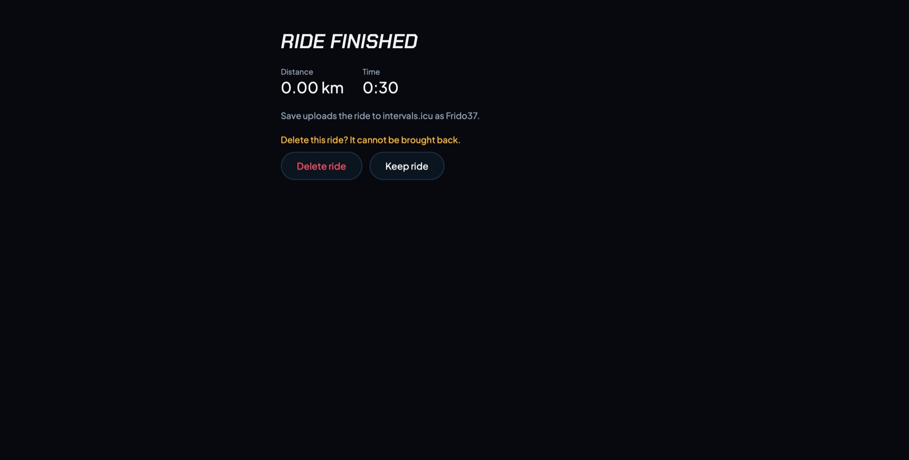

A bare column on black, with an italic capital headline, two numbers, a sentence and two pill buttons. The delete question turns the sentence amber and the button red text on a dark pill. There is no summary chart, no zone time and no sense of achievement after a ride. Of all the screens on the ride path, this one is the least finished.

### 2.9 Narrow layouts (simulated)

| Medium (900 pt) | Compact (420 pt) |
|---|---|
| 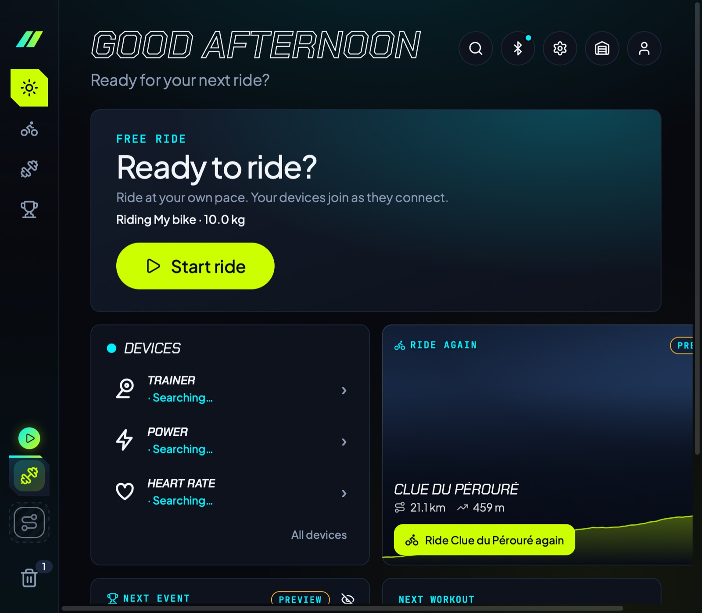 | 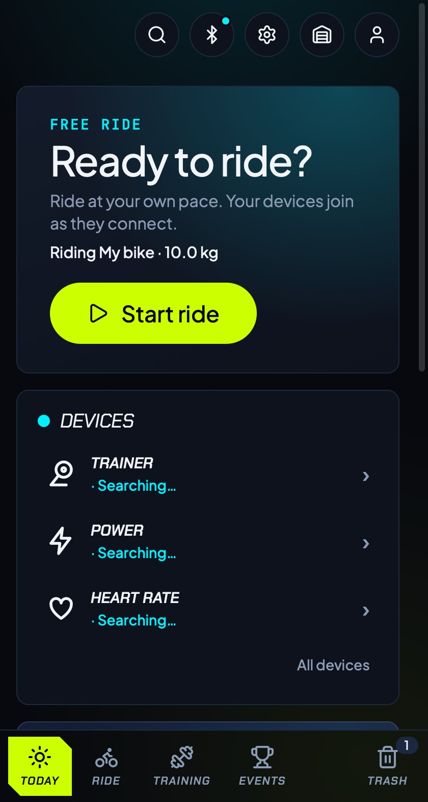 |

| Ride, compact | Training, compact | Drag over the trash, compact |
|---|---|---|
| 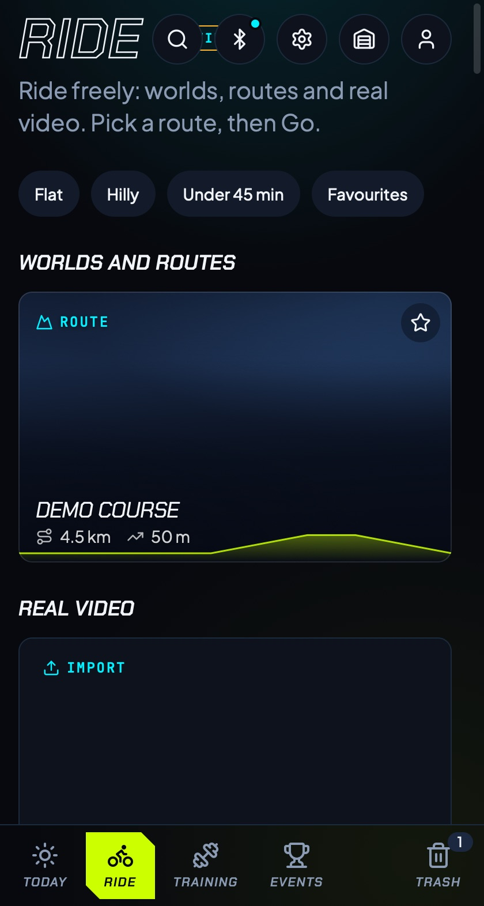 | 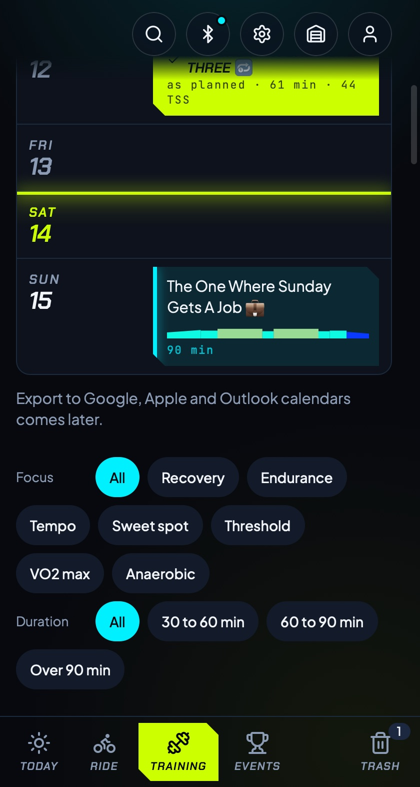 | 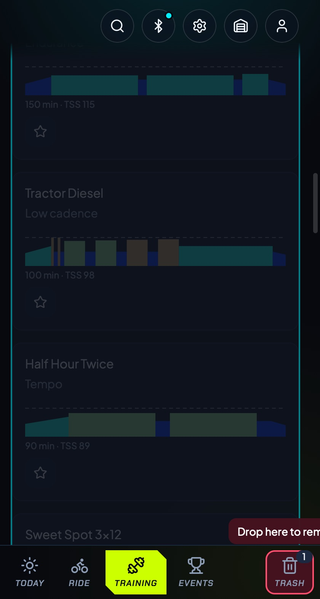 |

Also captured: [training library, compact](screenshots/53-training-compact-library.jpg) and [Ride, medium](screenshots/56-ride-medium.jpg).

- **Compact: the page title and the top-bar actions collide.** "RIDE" runs under the search button, and the "PREVIEW" badge is hidden behind it.
- **Compact: the trash hint is cut off** at the window's right edge ("Drop here to rem…"), because it is centred over a bar entry at the far right.
- **Compact bottom bar:** the current entry is a volt chamfered tile, the trash sits far right with a large gap, and its count badge overlaps its icon.
- **Medium:** the menu rail shows the next ride as icon tiles and the trash at the bottom. The current entry is a volt square. A horizontal scrollbar appeared in the simulation; it may be an artefact of the simulation.

---

## 3. The menu's bottom: next ride and trash

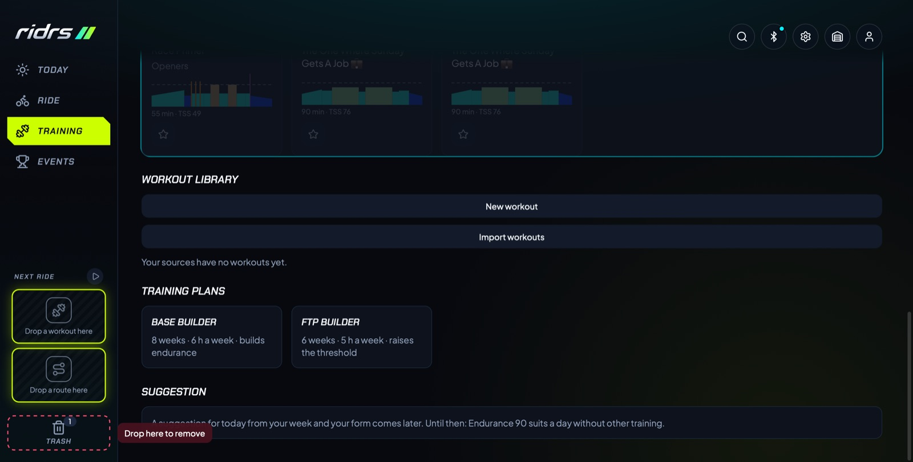
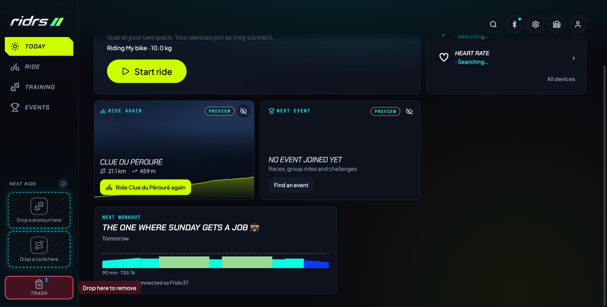
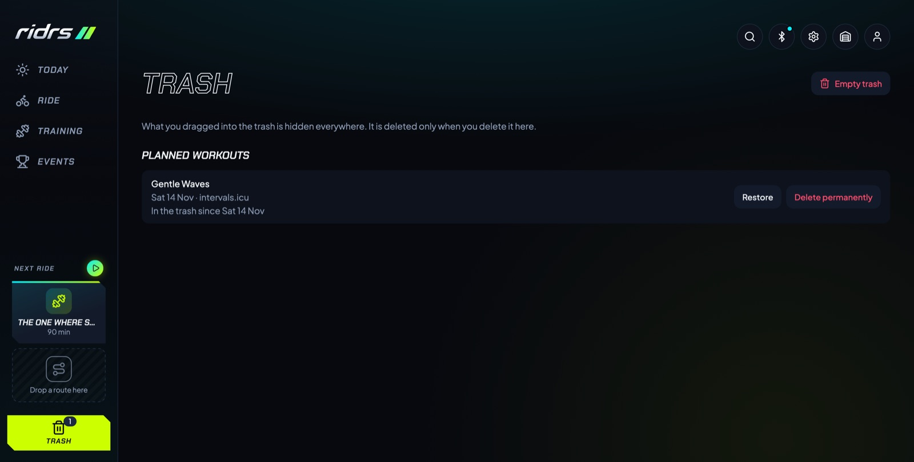

### 3.1 What exactly makes the trash feel unfinished

1. **It is a different kind of entry.** Menu entries are horizontal (24 px icon, 15 px label, 12 px/14 px padding). The trash is vertical (26 px icon over a 12 px label, centred, `plugins/ui-recycle-bin/client/index.tsx:36-38`). It sits under the next ride, which is a third layout (head plus two tall slots). The column has no common left edge: the entries' icons start at 26 px, the next ride's slots at 8 px, and the trash is centred.
2. **Spacing is patched, not designed.** `.mm-footer { margin-top: -16px }` (`plugins/ui-main-menu/client/index.tsx:38`) pulls the trash up against the 28 px menu gap. The trash has no visible separation from the next ride and no breathing room above the window edge (20 px).
3. **The count badge** is absolutely placed at `top: 2px; left: calc(50% + 8px)` (`index.tsx:39`), so it sits on the bin's lid. It is drawn with `--ridrs-surface-2`, a token nobody defines (fallback `#1c2840`), and uses `font: 600 12px system-ui` that the font layer replaces with a weight that is not loaded. It looks like an unread-messages bubble, not a count.
4. **States are inconsistent and incomplete:**
   - *Idle:* muted grey icon and label, as the other entries.
   - *Hover:* the menu's 12 px rounded surface.
   - *Current page:* a **full volt chamfered block** at the bottom of the window (see `13-trash-page`), the loudest object on screen for the least important page.
   - *Armed (a removable item is being dragged anywhere):* a **2 px dashed red outline with `outline-offset: -2px`** on a 12 px rounded button, with no fill (`index.tsx:45`). A dashed outline reads as "empty placeholder", the same language as the empty next-ride slots one entry above, which are dashed in a different colour (line grey, `ui-next-ride/client/index.tsx:73-76`), while the armed next-ride slots are dashed cyan and pulse (`:88`). Three dashed styles sit stacked within 300 px.
   - *Over:* the outline turns solid and the fill becomes `rgb(70 18 30 / .96)` (`index.tsx:46`), a wine colour that is not a token and appears nowhere else. The icon does not change (no lid opening), nothing scales, nothing is announced.
   - *Hint:* a wine pill "Drop here to remove" floats **outside the menu, over the page** (`left: calc(100% + 12px)`, `z-index: 1000`, `index.tsx:47`). It covers page content (it sat over "intervals.icu – Connected as …" in the screenshot) and is clipped on compact.
   - *Drop / after drop:* nothing. No confirmation, no "Moved to trash · Undo" toast, no count animation. The item disappears from the calendar and the number changes by one. For a reversible action the app does not tell the rider that it is reversible.
   - *Disabled* (dragging something the trash does not take, such as a library workout): the trash does not react at all, so the rider cannot tell "not here" from "not working".
5. **Wording contradicts the model.** The hint for a ride done says "Drop here to delete the ride", but a drop only moves it into the bin (ADR 0096: "A drop deletes nothing"). "Remove", "trash", "bin" and "delete permanently" are all used.
6. **Iconography:** the Lucide `trash-2` at 26 px beside 24 px menu icons, with no state variants (open lid, check after drop).
7. **Markup:** the entry's `<style>` element is a child of its `<button>` (`index.tsx:116`). The bridge's a11y audit reports the button's name as the whole CSS text plus "Trash 1". Real WebKit accessibility probably ignores the unrendered `<style>`, but a `<style>` inside a button is not valid content there, and the same pattern exists in other entries. The hint and count are `aria-hidden`. The count is reachable only as `aria-description`, and no live region announces a successful drop.
8. **The page behind it** is a plain list (`13-trash-page`). It has an outlined "TRASH" title, a red "Empty trash" text button in the head, and rows with grey "Restore" and red "Delete permanently". It is functional but has no empty-state illustration, no grouping by date and no explanation of how long things stay.

### 3.2 The next ride beside it

- *Empty slots:* a dashed outline in `--ridrs-line` (`#1b2a3c`, **1.37:1** against the background, so practically invisible) over faint diagonal stripes, with an icon in a ring. Stripes plus dashes plus a ring make three placeholder signals.
- *Filled slot:* a **chamfered** card with a cyan-to-volt gradient strip on top and a volt icon tile. It is the same race grammar as the calendar, sitting directly above the rounded trash.
- *Head:* "NEXT RIDE" in 11 px tracked capitals and a gradient (cyan to volt) play circle with a volt glow, the only gradient button in the app.
- Overall the section is good in function (one "Start next ride" control, two drop places), but it uses five decorations (stripes, dashes, ring, gradient strip, glow) where one shape and one accent would do.

---

## 4. Code-level style inventory

### 4.1 Where styling lives

- **No CSS files** except `apps/native/src/boot.css`. Every plugin writes CSS as a template string in a `.tsx`/`theme.tsx` and renders it in a `<style>` element (40 files). Widgets and the device setup use React inline styles (`setup.tsx` 49, `ui-widget-workout` 17, `ui-widget-virtual-gear` 11, every metric widget 6).
- **Tokens:** ADR 0058 defines the `--ridrs-*` custom properties. `plugins/ui-main-screen/client/index.tsx:18-22` sets a first set (blue/lime era: accent `#b8f53b`, info `#2aa8ff`, radius 16 px). `plugins/ui-main-screen/client/kinetic.tsx:26-29` overrides them with Kinetic (accent `#ccff00`, info `#00f0ff`, radius 12 px).
- **Shared look:** `packages/ui-preview/src/style.ts` (`pv-*`, cards, teasers, chips, hero) is the closest thing to a component library.
- **Font layer:** `kinetic.tsx` sets families by **class-name endings** (`-title`, `-name`, `-label`, `-eyebrow`, …) with `!important`. A class that happens to end in `-label` becomes cyan mono, and a title with another class name stays in the text face. That is why the editor's field labels are mono and the Sunday calendar entry is not in capitals.
- **Chart palette:** `plugins/ui-workout-chart/client/palette.ts` has its own `--wc-*` variables and is **the only part with a light theme**.

### 4.2 Colour

- **338** `var(--ridrs-…)` references, **278** of them with a hex fallback, and **263 raw colours** (130 distinct) outside tokens. The most common are `#fff` (34), `rgba(16,20,24,.72)` (10, the HUD), and `#27c8ff` (7, the old cyan).
- **Fallbacks disagree with the tokens and with each other:**

| Token | Kinetic value | Fallbacks found (count) |
|---|---|---|
| `--ridrs-accent` | `#ccff00` | `#27c8ff` (14), `#b8f53b` (10), `#ccff00` (7), `#00e5ff` (2) |
| `--ridrs-focus` | `#00f0ff` | `#fff` (8), `#8dff2a` (6), `#00f0ff` (4) |
| `--ridrs-line` | `#1b2a3c` | `#1f3447` (15), `#24324d` (11), `#1b2a3c` (10) |
| `--ridrs-surface` | `#0d121c` | `#0a1520` (14), `#131c2e` (11), `#0d121c` (3) |
| `--ridrs-text-muted` | `#8b9bb4` | `#8b9db2` (22), `#93a1b8` (18), `#8b9bb4` (13) |
| `--ridrs-danger` | **not defined** | `#ff4d6d` (4), `#ff5a5f` (3), `#ff5a6e` (2) |

  In 14 places `--ridrs-accent` falls back to *cyan*, so "accent" meant blue before Kinetic and means volt now. `--ridrs-danger`, `--ridrs-surface-2` and `--ridrs-on-accent` are used but never set.
- **Three copies of an old palette** as `COLORS` constants (`ui-devices/client/theme.tsx:26`, `ui-debriefing/client/index.tsx:31`, `ui-training-plan/client/theme.tsx:7`: cyan `#27c8ff`, lime `#8dff2a`, red `#ff4d5e`).
- **Three chart palettes:** power zones (10 saturated hues), grade (`profile-data.ts:15-20`, earthy green to purple), and the HUD progress (`#ccff00` hard-coded in `chart.tsx:96`).
- **Contrast** (WCAG, computed): text on bg 18.2:1, muted on surface 6.7:1, volt on bg 17:1, dark on cyan 14.1:1. All good. Weak points: **cyan focus ring on a volt selected entry 1.2:1**, lines `#1b2a3c` on bg 1.37:1 (the empty next-ride slots and card edges nearly vanish), and white on cyan 1.4:1 (fixed by ADR 0074 for the listed selectors only).

### 4.3 Typography

- **Families:** Plus Jakarta Sans (400, 500 bundled), Chakra Petch italic (400–600), JetBrains Mono (400, 500), all OFL-1.1 via Fontsource. Code still asks for `system-ui` in 1 CSS rule and in every inline-styled widget, but the `* { font-family … !important }` layer overrides it. `ui-monospace` appears in two places.
- **23 font sizes** in CSS (10, 11, 12, 13, 14, 15, 16, 17, 18, 19, 20, 22, 24, 26, 28, 30, 32, 34, 40, 48 px, 0.85 em, 0.9 em, a `15px !important`), plus inline 13, 14, 18, 44 and 48 in the HUD. The steps between 12 and 20 px are 1 px apart, so there is no scale.
- **Weights:** 700 (16 uses), 600 (8), 800 (4), 500 (4), 400 (2). With `font-synthesis: none` and only 400/500 of Plus Jakarta Sans loaded, **every 600/700/800 on text renders as 500**. Headline "800" in the briefing, debriefing and `pv-*` renders as Chakra 600. The code's intent and the screen disagree everywhere.
- **Letter spacing:** 7 values (−0.025, −0.02, 0.02, 0.06, 0.08, 0.12, 0.14 em).
- **Numerals:** tabular figures in 3 files (devices setup, garage, zones), none on the HUD, the calendar or workout stats.

### 4.4 Shape: radii and chamfers

- **CSS `border-radius`: 16 distinct values.** 999px (17 uses), 12px (14), 8px (11), 50% (10), `var(--ridrs-radius, 16px)` (7), `var(--ridrs-radius, 12px)` (3), 14px (3), 0 (3), 10px (2), 16px (2), 6px (2), 4px, 20px, 1px, `calc(var(--ridrs-radius,16px) + 8px)`, inherit.
- **Inline `borderRadius`: 12 more.** 14 (12 uses, HUD tiles), 10 (4), 1 (3), 50% (3), 999 (2), 12 (2), 8 (2), 6, 2 (2), 18, 11, `16px 16px 0 0`.
- **Chamfers** (`clip-path: polygon(...)`): 12 px at `ui-main-menu/client/index.tsx:53`, `ui-next-ride/client/index.tsx:81`, `ui-area-training/client/week.tsx:432`; 8 px at `week.tsx:500`.
- That is **14 distinct lengths between 1 and 24 px**, plus pill, circle and chamfer, and **no rule** for which to use. The token `--ridrs-radius` is 12 px, but 7 places fall back to 16 px, so the same card is 16 px wherever the token does not reach.

### 4.5 Spacing, borders, elevation, motion

- **Spacing:** 52 distinct `gap` values and 86 distinct `padding` values. `--ridrs-gap` (16 px) is used 10 times.
- **Borders:** 1 px, 1.5 px, 2 px and 3 px, solid and dashed, with 25 distinct declarations. 1.5 px is used for the old-palette themes only.
- **Shadows:** 18 distinct, and **16 of them are glows** (`0 0 12–26px` in volt/cyan/green) in the calendar, next ride and menu. There is exactly one elevation shadow (the dialog). The glows are what makes the training side look "aggressive".
- **Motion:** 0.15 s (most), 0.25 s, 0.4 s ease. Six keyframe animations, three of them identical spinners under three names (`rd-spin`, `db-spin`, `rt-spin`). `nr-pulse` and `tw-sweep` are infinite. `prefers-reduced-motion` is handled in 7 places. Nothing animates in the HUD, which is right.

### 4.6 Focus (AGENTS.md rule 12)

- **Seven focus styles:** `3px solid var(--ridrs-focus, #fff)` (8), `2px solid var(--ridrs-focus, #8dff2a)` (5), `3px solid var(--ridrs-focus, #00f0ff)` (3), `2px solid #8dff2a` (2), `3px solid #ffd60a` (virtual gear, yellow), `3px solid #5aa9e6` (`boot.css:45`, blue), and a `box-shadow` ring on the next ride. Offsets are 2 px or 3 px, and some places use `outline: none`.
- **The current menu entry cannot show focus.** `clip-path` on `[aria-current="page"]` (`ui-main-menu/client/index.tsx:51-54`) clips the outline away, and even unclipped the cyan ring on volt would be 1.2:1. Verified live:

  | Focus on a normal entry (Ride), the next ride and an action | Focus on the current entry (Today) |
  |---|---|
  | 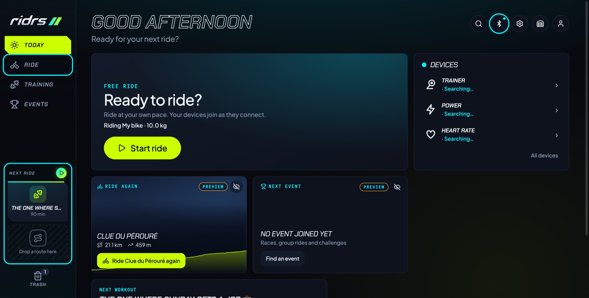 | 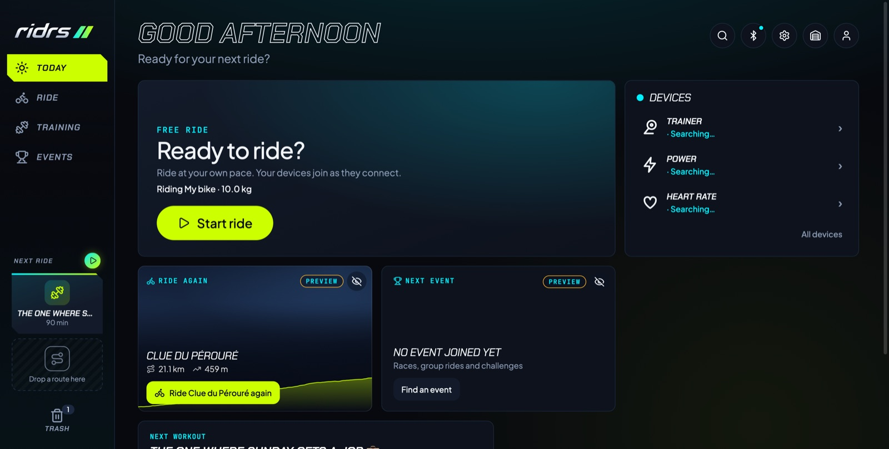 |

  The menu is how the rider reaches Ride and "Start next ride" by keyboard or controller, so this conflicts with rule 12 ("the focused element is always clearly visible").
- The same clipping hits **calendar entries**: `.tw-entry-open:focus-visible` draws its outline at 3 px offset inside an `li` clipped by `clip-path` (`week.tsx:432,435`), so most of the ring is cut. The calendar is off the ride path, but it is also where the next ride is assembled.
- **The HUD's Pause and Finish ride** get only the WebKit default focus ring (or `boot.css`'s blue ring), not the app's.
- Selected-versus-focused is handled carefully in the briefing (a filled edge and a check, never a ring). That should become the rule everywhere.

### 4.7 Dark and light

Dark only. `prefers-color-scheme` appears once, in the workout chart palette. The briefing's comment claims "light and dark follow the app", but no light tokens exist. A bright room or a phone outdoors gets no light theme.

### 4.8 Icons

Lucide (ISC) SVGs painted as CSS masks in the text colour: 27 distinct files copied into plugin folders, plus hand-drawn icons in the devices plugin and the wordmark. Icon sizes: 14, 15, 16, 18, 20, 24, 26 px, with stroke width inherited from Lucide (2 px at 24). It is a consistent source with inconsistent sizes.

---

## 5. Diagnosis: workouts versus rides

1. **Two grammars, one product.** The calendar, the menu's selected state and the next ride's filled slots use the race grammar (chamfer, solid neon fill, glow, italic capitals, mono labels). Rides use the gallery grammar (rounded, photographic, glass, sentence case under capital titles). ADR 0074 brought the race grammar in through fonts and a few class names. It never decided **which shape the product has**, so each plugin chose its own.
2. **Neon as fill, not as signal.** Volt is the primary-action colour (Start ride, Go) *and* the fill of every done workout *and* the current menu entry *and* today's column. When half the calendar is volt, volt stops meaning "act here".
3. **Hard data, soft media.** Zone charts are hard rectangles in ten saturated hues, while route profiles are smooth curves in earth tones. The two are the same kind of thing (a profile of effort over time) drawn as opposites.
4. **The font layer by class names** makes the look depend on naming accidents (`-label` becomes mono cyan, `tr-entry` escapes capitals).
5. **The ride itself never got a design.** The most important screen, the one seen for an hour from 2 m, is the least designed.

## 6. What works and should be kept

- The **brand assets**: wordmark, the two slashes, volt as *the* action colour, the near-black base, and the outlined page title used once per page.
- **Picture cards** on Ride: the 16:10 grid, scrim, profile along the bottom edge, and glass tool buttons.
- **Token contract** (ADR 0058) and the idea that contributions draw with tokens. It only needs completing and enforcing.
- **Selected ≠ focused** discipline (briefing, `pv-*` toggles filled, never outlined).
- **Colour-blind-checked zone ramp** with names in tooltips (the method, not necessarily the hues).
- **Reduced-motion handling** where motion exists, and no motion in the HUD.
- **Big targets:** the 44 px top-bar actions and the 40 px buttons.
- **The next ride as one control** with two drop places, and the bin as a reversible step before deletion (ADR 0096). The interaction model is right; only its look is unfinished.

## 7. Top findings, ranked

1. **Three and a half visual languages** with no shape rule: 14 radius lengths plus a chamfer, used by plugin, not by role.
2. **The ride screen is unstyled** (browser buttons, inline-styled tiles, debug panel, no tabular figures).
3. **Focus is invisible on the current menu entry** (clip-path plus 1.2:1 contrast) and clipped on calendar entries: a rule-12 problem.
4. **The trash is a fourth entry type** with patched spacing, an undefined-token badge, a dashed "placeholder" armed state, a floating clipped hint, no drop feedback and "delete" wording for a reversible move.
5. **Tokens exist but do not govern:** 263 raw colours, conflicting fallbacks (accent is cyan in 14 places), undefined tokens (`--ridrs-danger`), weights that are not loaded, and a font layer keyed on class names.
