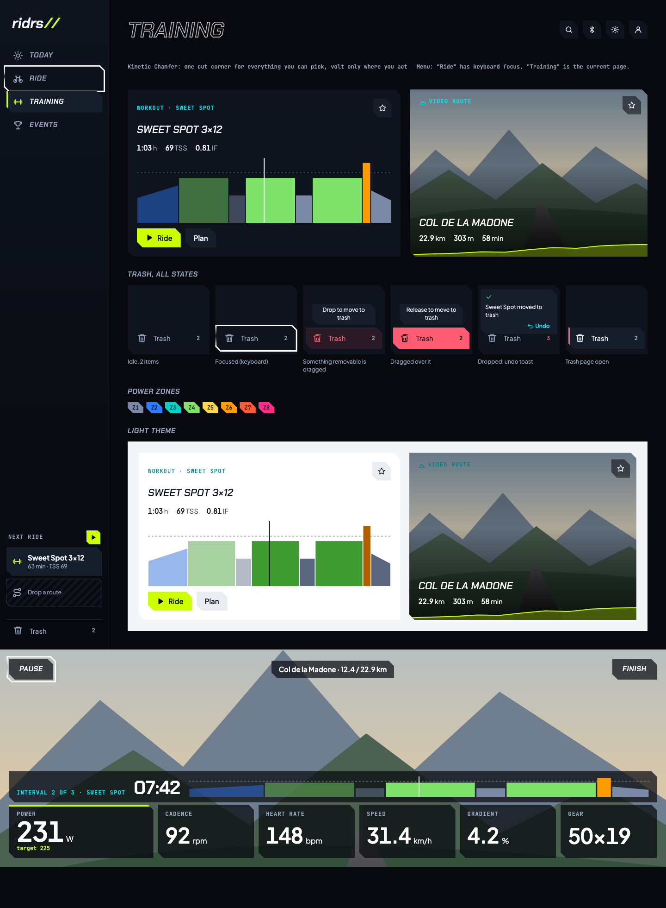

<!-- SPDX-License-Identifier: CC-BY-SA-4.0 -->

# Concept 1: Kinetic Chamfer

> **One cut corner for everything you can pick. Volt only where you act.**

[`mockup.html`](mockup.html) (self-contained; fonts from Google Fonts for the mockup only).

## Idea and personality

This concept finishes the Kinetic look instead of replacing it. Today the chamfer (the cut corner) is used in four places and fights the rounded cards everywhere else. Here it becomes **the** shape of ridrs: every object a rider can pick, drag or press (menu entries, cards, buttons, slots, HUD tiles) has the same diagonal cut on the top-right and bottom-left corners, at three sizes. Containers (the menu column, pages, dialogs) stay square. Glows go away. Volt stops being a fill for "done" and "current" and is kept for "act here": Start, Ride, Go, the play button and the target power.

- **Mood:** fast, technical, confident. Motorsport pit board rather than arcade.
- **Suits:** riders who like the current brand and the ridrs.app page; the maintainer if continuity matters most.
- **Inspirations (described, not copied):** race-car livery panels with bevelled number plates; the angular cut of carbon parts and of stadium signage; the ridrs.app web page itself.

## How it resolves workouts versus rides

- **Same shape for both.** A ride card and a workout card are the same chamfered card (14 px cut). The picture of a route is clipped to that shape, so the photo card stops being "soft".
- **Same weight for both.** The calendar's done entries lose their volt fill and glow: a done workout is a raised chamfer with a 3 px volt edge and a check icon, the same way the current menu entry is marked. A planned workout has a cyan edge. Volt fill is only for buttons.
- **Charts are calmed down, not rounded.** Bars keep hard corners (it is a chamfer system, not a soft one), but done steps fade to 45 %, the ten-hue ramp becomes eight steps that run cool to warm without jumps (see the zones table), and no glow is drawn.
- **Type is shared:** Chakra Petch italic capitals for card titles in both catalogues, Plus Jakarta Sans for facts, JetBrains Mono only for eyebrows (never for field labels or sentences).

## The trash, redesigned

The trash becomes **a normal menu entry**: the same height, icon size (22 px), padding and left alignment as Today, Ride, Training and Events, with the count right-aligned in mono. A hairline (`--ridrs-line`) separates it from the next ride. The negative margin goes away.

| State | Look | Motion | Announcement |
|---|---|---|---|
| Idle | muted icon and label, count in mono at the right | none | name "Trash, 2 items" |
| Hover | raised chamfer fill | 120 ms fill fade | – |
| Focus | chamfered white ring 3 px, 3 px page-colour gap (see focus) | none | – |
| Armed (a removable thing is dragged anywhere) | danger-tinted chamfer (12 % `--ridrs-danger`), icon switches to the open lid, a small chamfered hint **above** the entry, inside the menu ("Drop to move to trash") | 120 ms fill fade | – |
| Over | solid `--ridrs-danger` chamfer, dark text, open lid | 80 ms | – |
| Dropped | count ticks up in danger colour for 2 s; a chamfered toast at the bottom of the page: "Sweet Spot moved to trash · Undo" (Undo restores through `trash.restore`) | toast slides 8 px and fades in 160 ms, stays 6 s | `role="status"` live region reads the toast |
| Refused (dragging something the trash does not take) | stays idle; the cursor shows "not allowed" | none | – |
| Current page | raised chamfer with a 3 px **danger** edge (not a volt block) | none | `aria-current="page"` |

Wording: "Drop to move to trash" for everything, including rides done ("Drop to move the ride to trash"), because the drop never deletes. "Delete permanently" is said only on the trash page.

## Tokens

### Colour

Dark is the main theme. Light is for daytime rooms and the phone outdoors. Every pair below was computed against WCAG 2.2 (text 4.5:1, large text and UI parts 3:1).

**Semantic roles:** `bg` page, `surface` cards and the menu, `raised` hover, selected and buttons, `line` decorative hairlines, `line-strong` input borders and empty-slot outlines (3:1), `text`/`muted`, `accent` (volt, only for actions, with `accent-text` on it), `accent-ink` (volt as text: dark theme only; a darker olive in light), `info` (cyan: planned, links, eyebrows), `ok`/`warn`/`danger`, `focus`.

Contrast ratios are computed with the WCAG 2.x relative-luminance formula. The focus ring is always separated from fills by a gap in the page colour, so it is checked against `bg` and `surface`.

**Dark**

| Role | Token | Value |
|---|---|---|
| bg | `--ridrs-bg` | `#07090e` |
| surface | `--ridrs-surface` | `#0e131d` |
| raised | `--ridrs-raised` | `#161d2b` |
| line | `--ridrs-line` | `#222e40` |
| line-strong | `--ridrs-line-strong` | `#5a6a82` |
| text | `--ridrs-text` | `#f1f5f9` |
| muted | `--ridrs-muted` | `#97a6bd` |
| accent | `--ridrs-accent` | `#ccff00` |
| accent-text | `--ridrs-accent-text` | `#07090e` |
| accent-ink | `--ridrs-accent-ink` | `#ccff00` |
| info | `--ridrs-info` | `#00e5f0` |
| ok | `--ridrs-ok` | `#3ddc84` |
| warn | `--ridrs-warn` | `#ffb62e` |
| danger | `--ridrs-danger` | `#ff5c74` |
| focus | `--ridrs-focus` | `#ffffff` |

| Pair (dark) | Ratio | Needs | Result |
|---|---|---|---|
| text on bg | 18.2:1 | 4.5:1 | pass |
| text on surface | 17.0:1 | 4.5:1 | pass |
| muted on bg | 8.1:1 | 4.5:1 | pass |
| muted on surface | 7.5:1 | 4.5:1 | pass |
| muted on raised | 6.8:1 | 4.5:1 | pass |
| accent-text on accent | 16.9:1 | 4.5:1 | pass |
| accent-ink on bg | 16.9:1 | 4.5:1 | pass |
| accent-ink on surface | 15.8:1 | 4.5:1 | pass |
| info on bg | 12.8:1 | 3.0:1 | pass |
| ok on surface | 10.4:1 | 3.0:1 | pass |
| warn on surface | 10.6:1 | 3.0:1 | pass |
| danger on surface | 6.2:1 | 4.5:1 | pass |
| line-strong on surface | 3.4:1 | 3.0:1 | pass |
| focus on bg | 19.9:1 | 3.0:1 | pass |
| focus on surface | 18.6:1 | 3.0:1 | pass |

| Zone (dark) | Colour | vs bg | vs neighbour |
|---|---|---|---|
| Z1 | `#7a8aa6` | 5.7:1 | – |
| Z2 | `#2f7dff` | 5.2:1 | 1.09 |
| Z3 | `#00d2c8` | 10.5:1 | 2.01 |
| Z4 | `#7fe36b` | 12.4:1 | 1.19 |
| Z5 | `#ffd84d` | 14.4:1 | 1.16 |
| Z6 | `#ff9d00` | 9.6:1 | 1.51 |
| Z7 | `#ff5a36` | 6.4:1 | 1.49 |
| Z8 | `#ff2e8a` | 5.7:1 | 1.13 |

**Light**

| Role | Token | Value |
|---|---|---|
| bg | `--ridrs-bg` | `#f3f5f8` |
| surface | `--ridrs-surface` | `#ffffff` |
| raised | `--ridrs-raised` | `#e9edf2` |
| line | `--ridrs-line` | `#d5dce6` |
| line-strong | `--ridrs-line-strong` | `#7b8799` |
| text | `--ridrs-text` | `#0b1220` |
| muted | `--ridrs-muted` | `#4b5668` |
| accent | `--ridrs-accent` | `#ccff00` |
| accent-text | `--ridrs-accent-text` | `#07090e` |
| accent-ink | `--ridrs-accent-ink` | `#4a6600` |
| info | `--ridrs-info` | `#007c85` |
| ok | `--ridrs-ok` | `#13804a` |
| warn | `--ridrs-warn` | `#9a5b00` |
| danger | `--ridrs-danger` | `#c8283f` |
| focus | `--ridrs-focus` | `#0b1220` |

| Pair (light) | Ratio | Needs | Result |
|---|---|---|---|
| text on bg | 17.1:1 | 4.5:1 | pass |
| text on surface | 18.7:1 | 4.5:1 | pass |
| muted on bg | 6.8:1 | 4.5:1 | pass |
| muted on surface | 7.4:1 | 4.5:1 | pass |
| muted on raised | 6.3:1 | 4.5:1 | pass |
| accent-text on accent | 16.9:1 | 4.5:1 | pass |
| accent-ink on bg | 6.0:1 | 4.5:1 | pass |
| accent-ink on surface | 6.6:1 | 4.5:1 | pass |
| info on bg | 4.6:1 | 3.0:1 | pass |
| ok on surface | 5.0:1 | 3.0:1 | pass |
| warn on surface | 5.4:1 | 3.0:1 | pass |
| danger on surface | 5.5:1 | 4.5:1 | pass |
| line-strong on surface | 3.6:1 | 3.0:1 | pass |
| focus on bg | 17.1:1 | 3.0:1 | pass |
| focus on surface | 18.7:1 | 3.0:1 | pass |

| Zone (light) | Colour | vs bg | vs neighbour |
|---|---|---|---|
| Z1 | `#5a6680` | 5.3:1 | – |
| Z2 | `#1b5fd6` | 5.3:1 | 1.00 |
| Z3 | `#008c86` | 3.8:1 | 1.39 |
| Z4 | `#3f9a2f` | 3.3:1 | 1.15 |
| Z5 | `#8a6d00` | 4.5:1 | 1.38 |
| Z6 | `#b35f00` | 4.2:1 | 1.07 |
| Z7 | `#d23c1c` | 4.4:1 | 1.03 |
| Z8 | `#c8186a` | 5.1:1 | 1.16 |

The zone ramp no longer uses volt, so volt still means "act". Neighbouring zones differ by hue more than by lightness. The chart therefore always prints the zone name in the tooltip and on the legend, and the existing colour-blind check (`plugins/ui-workout-chart/client/palette.test.ts`) must be run again on the new values before adoption.

### Typography

| Role | Family (licence) | Size / line | Weight | Case |
|---|---|---|---|---|
| Page title (outlined, once per page) | Chakra Petch italic (OFL-1.1) | 46/1.0 | 600 | upper |
| Section and card titles | Chakra Petch italic | 15, 22/1.1 | 500–600 | upper |
| Body, facts, buttons | Plus Jakarta Sans (OFL-1.1) | 13, 15, 17 | 400, 500, 600 | sentence |
| Eyebrows, counts, small data labels | JetBrains Mono (OFL-1.1) | 12 | 500 | upper, 0.1 em |
| HUD values | Plus Jakarta Sans, tabular figures | 46, key metric 58 | 600 | – |
| HUD timer | Chakra Petch upright, tabular | 40 | 600 | – |

Scale: 12, 13, 15, 17, 22, 28, 46, 58 (it replaces the 23 sizes in use). Bundle **600 of Plus Jakarta Sans** (missing today, which is why every "bold" renders as 500) and drop 700/800 from the code. `font-variant-numeric: tabular-nums` on every number that changes (HUD, timers, stats, the calendar). Plus Jakarta Sans's `tnum` feature has to be checked in the bundled files. If it is missing, the HUD numbers fall back to JetBrains Mono.

Remove the class-name font layer. Plugins use four classes from the look sheet instead (`ridrs-display`, `ridrs-eyebrow`, `ridrs-num`, `ridrs-body`) or the matching tokens (`--ridrs-font-display`, …).

### Spacing

4 px base: 4, 8, 12, 16, 20, 24, 32, 40, 56. Cards pad 20, menu entries 12/14, page gutter 40 (16 on compact), card gap 20.

### Shape: one rule

**Everything you can pick is chamfered. Everything that holds things is square.** The cut size follows the object's size:

| Token | Cut | Used for |
|---|---|---|
| `--ridrs-cut-s` | 6 px | chips, zone tags, hints, count badges |
| `--ridrs-cut-m` | 8 px | buttons, icon buttons, menu entries, slots, toasts, HUD buttons |
| `--ridrs-cut-l` | 14 px | cards, picture cards, HUD tiles, dialogs' inner panels |
| — | 0 | the menu column, pages, dialog frames, full-bleed pictures |

No `border-radius` anywhere except two things that are round by nature: the progress dot in charts and avatars.

**Implementation rule (the fix for the focus bug):** an element never clips itself. Its fill is drawn on `::before` with `clip-path: var(--ridrs-chamfer)`, so its outline and its `::after` focus ring are never clipped. The mockup shows the technique; it needs one shared CSS block in the look sheet.

### Elevation and borders

No shadows and no glows. Depth comes from three surface steps (`bg` → `surface` → `raised`). Borders: 1 px `line` for dividers, 1 px `line-strong` for inputs and empty slots (drawn as a chamfered hairline ring, not dashed). A 3 px coloured edge on the left (or top for HUD tiles) means "state": volt = current/active, cyan = planned, danger = trash.

### Icons

Lucide (ISC), 2 px stroke, at 22 px in menus and 18 px in buttons. Two sizes only. State variants: `trash-2` / an open-lid trash, `check` for done.

### Motion

| What | Duration | Easing |
|---|---|---|
| Hover/press fills | 120 ms | `cubic-bezier(.2,0,0,1)` |
| Toast in / out | 160 ms / 120 ms | same |
| Page and dialog change | 180 ms opacity only | same |

**Never during a ride:** no transitions on HUD values, no pulses, no sweeps, no scale. The current step in the HUD chart moves by data only. Infinite animations (`nr-pulse`, `tw-sweep`) are replaced by static states. `prefers-reduced-motion` turns all of the above into instant changes.

### Focus (rule 12)

A **chamfered white ring** (`--ridrs-focus`, 3 px) drawn 3 px outside the element on `::after`, with the page colour as the gap. It is visible on every fill: white on near-black is 18:1, and the gap separates it from volt and danger fills. Selected and current states never use a ring. They use a fill plus an edge, so nothing looks focused unless it is. In light mode the ring is `#0b1220`.

## Component rules

- **Buttons:** chamfer-m. Primary is volt with dark text; secondary is `raised`; destructive is `raised` with danger text, turning solid danger only inside a confirmation. Minimum height 44 px (56 px on the ride path and the HUD).
- **Cards and tiles:** chamfer-l, `surface`, padding 20, eyebrow (mono, cyan), title (Chakra italic), facts (Jakarta 600 numbers + muted units), actions at the bottom in one row.
- **Lists:** rows 52 px, a 1 px divider, a chamfer-m hover fill. The selected row gets a 3 px volt left edge.
- **Menu:** entries as lists. Current = `raised` + volt edge + volt icon. The next ride and the trash share the entries' left edge and icon size.
- **Top bar:** 44 px chamfer-m icon buttons on `surface`. The state dot becomes a 3 px edge at the bottom of the button.
- **Dialogs:** a square frame on a 66 % scrim, title in Jakarta 600 (not outlined), close as a chamfer-m icon button.
- **Form fields:** chamfer-m, 1 px `line-strong`, labels in Jakarta 500 13 px muted (not mono).
- **Chips and tags:** chamfer-s. Selected = `raised` + volt edge, or cyan fill with dark text for filters.
- **Workout interval chart:** square bars, 2 px gaps, zone colours, done steps at 45 %, the current position as a 2 px `text` line, FTP as a 1 px dashed muted line. No glow. Hatching for steps without zones (as today).
- **Ride and route cards:** picture clipped to chamfer-l, a bottom scrim, the elevation profile along the bottom edge in volt (the only volt that is not an action; it reads as "your route").
- **HUD metrics:** chamfer-l tiles on `rgb(7 9 14 / .74)`, label mono 12 px, value 46 px tabular, unit 16 px. The key metric (power in a workout, speed otherwise) is wider, 58 px, with a volt top edge and the target in volt mono.
- **Trash and drop zones:** see above. The next ride's empty slots use the same hairline chamfer ring plus faint stripes. When armed they turn `info` tinted; when over, `info` solid edge.
- **Empty states:** a large muted Lucide icon, one sentence and one action, inside a chamfer-l `surface`.

## Screen by screen

- **Main menu:** brand at the top; entries; the next ride (a section with an eyebrow, a volt chamfered play, and two slots); a hairline; the trash. Current = raised + volt edge.
- **Workouts (Training):** the calendar uses the same chamfered entry as the library card's compact form. Today's column is marked by a volt 3 px top edge without glow. Done = check + volt edge, planned = cyan edge, rest = muted edge.
- **Rides catalogue:** the picture grid stays as it is; only the card shape changes to chamfer-l, and cards without a picture get an illustrated elevation silhouette instead of the empty navy gradient.
- **Briefing:** one column of chamfer-l sections. "Start" is a full-width 56 px volt button pinned to the bottom of the viewport, so it is always in reach by Enter.
- **In-ride HUD:** the bottom strip shown in the mockup; Pause and Finish as chamfer-m dark buttons with the app's focus ring; the debug panel only behind a developer setting.
- **Debriefing:** a chamfer-l summary card (distance, time, average power, TSS, zone time bar), the route profile with the ridden part in volt, then Save (volt), Save without upload, Delete (danger text) in one row.
- **Settings:** list rows in sections with Chakra italic capital heads. Chips for choices, steppers as chamfer-m buttons.

## Pros, cons and risks

**Pros**
- Keeps the brand, fonts, logo and ADR 0074. The least disruptive concept, and the one closest to what riders already know.
- One shape rule removes the race-versus-gallery split without making the app soft.
- Fixes the focus bug structurally (fill on `::before`, ring on `::after`).
- Volt regains its meaning.

**Cons**
- Chamfers need the `::before`/`::after` technique everywhere. Plain `border-radius` would be simpler, and native controls (selects, inputs) cannot be chamfered exactly.
- A clipped photo card loses a little of its softness, which some will miss.
- Italic capitals are still harder to read than sentence case for long names (two lines at most, then an ellipsis).

**Risks**
- Two pseudo-elements per component collide with components that already use `::before`/`::after` (the teaser card, the calendar entry). Each needs an inner element.
- CSS `corner-shape: bevel` would solve this natively, but WebKit does not ship it yet. Do not wait for it.

**Effort:** medium (about 2–3 weeks). The look sheet and shared CSS take 2 days, `@ridrs/ui-preview` 2 days, the menu, next ride and trash 2 days, the calendar 1 day, the HUD and activity screen 3 days, and the remaining old-palette plugins 1 week.

**Migration path**
1. `plugins/ui-main-screen/client/kinetic.tsx` → a complete token sheet: add `--ridrs-danger`, `--ridrs-line-strong`, `--ridrs-cut-s/m/l`, `--ridrs-chamfer`, the font-role tokens and the light set. Delete the duplicate token defaults in `ui-main-screen/client/index.tsx:18-22`.
2. One shared `CHAMFER_CSS` and focus-ring block in `packages/ui-preview/src/style.ts`. Convert `pv-card`, `pv-teaser`, `pv-button`, `pv-chip` and `pv-icon`.
3. `ui-main-menu`, `ui-next-ride`, `ui-recycle-bin` (the trash states and the toast, the `<style>` moved out of the button), `ui-area-training/client/week.tsx` (remove glows and `clip-path` on the `li`).
4. `ui-activity-screen` and every `ui-widget-*`: inline styles → classes on tokens; tabular figures.
5. Remove the three `COLORS` constants and all fallbacks that disagree (one lint check: no hex in plugin CSS except in the look sheet).
6. An ADR "Kinetic, finished" that supersedes the font layer of ADR 0074.

**Rule 12 fit:** very good once the ring is drawn outside the clip. Every focusable thing has the same ring, and selected states never look focused.

**Platforms:** the same on macOS WebKit and Android WebView (`clip-path: polygon` is supported in both). On Android, 44/56 px targets and the compact bottom bar keep the chamfered current entry.
