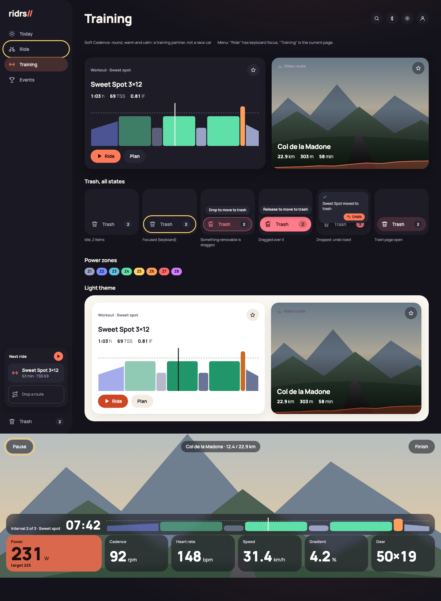

<!-- SPDX-License-Identifier: CC-BY-SA-4.0 -->

# Concept 2: Soft Cadence

> **Round, warm and calm: a training partner, not a race car.**

[`mockup.html`](mockup.html) (self-contained; fonts from Google Fonts for the mockup only).

## Idea and personality

This concept goes the other way from today's race look. The whole app takes the **soft grammar the rides already have** and pushes it further: rounded shapes whose radius grows with their size, gentle depth, a warm dusk palette (aubergine-black, coral, sunflower, mint) and one friendly sans with rounded geometry. The workouts become as approachable as the rides. Intensity is shown by colour and height, not by sharp shapes and neon.

- **Mood:** warm, encouraging, unhurried; evening light on a long ride.
- **Suits:** riders who train for health and enjoyment, riders who find structured training intimidating, households where the app sits on a TV in the living room.
- **Inspirations (described, not copied):** fitness-tracker activity rings and soft health dashboards; bike-touring guidebooks; sunset gradients on video rides.

## How it resolves workouts versus rides

- **The rides' shape wins.** Cards are 24 px, controls are pills, and sheets (dialogs, the menu panel) are 32 px. Workouts, routes, events and settings use the same card.
- **Charts become soft.** Interval bars get 6 px rounded tops and 3 px gaps, so a workout reads like a skyline, not a saw. Done steps fade to 50 %. The current position is a 3 px rounded line. Zones run periwinkle → sky → mint → sunflower → apricot → coral → orchid, softer than today and colour-blind-checked by the same method.
- **Achievement without neon.** A done workout in the calendar is a mint-tinted pill with a check. The current day is a soft coral column tint. Nothing glows.
- **One family.** Manrope everywhere, with weight doing the hierarchy (800 titles, 600 labels, 400 text).

## The trash, redesigned

The trash is a **pill entry like the others**, separated from the next ride by the next ride's own card.

| State | Look | Motion | Announcement |
|---|---|---|---|
| Idle | muted icon and label, a round count bubble (`raised`) at the right | none | "Trash, 2 items" |
| Hover | `raised` pill fill | 200 ms | – |
| Focus | sunflower ring 3 px, offset 3 px | none | – |
| Armed | soft red pool (16 % danger) with a 2 px inner rim, open-lid icon, a pill hint floating **above** it inside the menu ("Drop to move to trash") | 200 ms fade | – |
| Over | solid soft red, dark text, scales to 1.04 (on macOS only; never during a ride) | 200 ms spring-like `cubic-bezier(.3,1.4,.6,1)` | – |
| Dropped | the bubble turns danger-coloured and bumps once; a rounded toast with a coral **Undo** pill appears at the bottom centre | 240 ms in, 6 s hold | `role="status"` |
| Refused | idle, "not allowed" cursor | – | – |
| Current page | danger-tinted pill on `surface` | – | `aria-current` |

## Tokens

### Colour

**Semantic roles:** `accent` coral = act (Start, Ride, Undo), `focus` sunflower = where the keyboard is, `info` sky = planned and links, `ok` mint = done, `warn` honey, `danger` soft red.

Contrast ratios are computed with the WCAG 2.x relative-luminance formula. The focus ring is always separated from fills by a gap in the page colour, so it is checked against `bg` and `surface`.

**Dark**

| Role | Token | Value |
|---|---|---|
| bg | `--ridrs-bg` | `#14131b` |
| surface | `--ridrs-surface` | `#1d1c27` |
| raised | `--ridrs-raised` | `#272635` |
| line | `--ridrs-line` | `#34334a` |
| line-strong | `--ridrs-line-strong` | `#77758f` |
| text | `--ridrs-text` | `#f6f2ec` |
| muted | `--ridrs-muted` | `#aeaabb` |
| accent | `--ridrs-accent` | `#ff7a59` |
| accent-text | `--ridrs-accent-text` | `#1c0e09` |
| accent-ink | `--ridrs-accent-ink` | `#ff8f73` |
| info | `--ridrs-info` | `#6fd6ff` |
| ok | `--ridrs-ok` | `#5fe0b0` |
| warn | `--ridrs-warn` | `#ffc861` |
| danger | `--ridrs-danger` | `#ff7d8a` |
| focus | `--ridrs-focus` | `#ffd166` |

| Pair (dark) | Ratio | Needs | Result |
|---|---|---|---|
| text on bg | 16.5:1 | 4.5:1 | pass |
| text on surface | 15.1:1 | 4.5:1 | pass |
| muted on bg | 8.1:1 | 4.5:1 | pass |
| muted on surface | 7.4:1 | 4.5:1 | pass |
| muted on raised | 6.5:1 | 4.5:1 | pass |
| accent-text on accent | 7.3:1 | 4.5:1 | pass |
| accent-ink on bg | 8.3:1 | 4.5:1 | pass |
| accent-ink on surface | 7.6:1 | 4.5:1 | pass |
| info on bg | 11.2:1 | 3.0:1 | pass |
| ok on surface | 10.2:1 | 3.0:1 | pass |
| warn on surface | 11.0:1 | 3.0:1 | pass |
| danger on surface | 6.9:1 | 4.5:1 | pass |
| line-strong on surface | 3.8:1 | 3.0:1 | pass |
| focus on bg | 12.8:1 | 3.0:1 | pass |
| focus on surface | 11.7:1 | 3.0:1 | pass |

| Zone (dark) | Colour | vs bg | vs neighbour |
|---|---|---|---|
| Z1 | `#9aa3c7` | 7.4:1 | – |
| Z2 | `#7c8cff` | 6.2:1 | 1.20 |
| Z3 | `#5fc3e4` | 9.1:1 | 1.48 |
| Z4 | `#5fe0a8` | 11.2:1 | 1.22 |
| Z5 | `#ffd166` | 12.8:1 | 1.15 |
| Z6 | `#ff9f5a` | 9.1:1 | 1.41 |
| Z7 | `#ff6b6b` | 6.6:1 | 1.37 |
| Z8 | `#d77bff` | 7.2:1 | 1.08 |

**Light**

| Role | Token | Value |
|---|---|---|
| bg | `--ridrs-bg` | `#faf6f0` |
| surface | `--ridrs-surface` | `#ffffff` |
| raised | `--ridrs-raised` | `#f2ece3` |
| line | `--ridrs-line` | `#e6ddd0` |
| line-strong | `--ridrs-line-strong` | `#8e8577` |
| text | `--ridrs-text` | `#1e1b27` |
| muted | `--ridrs-muted` | `#5d586a` |
| accent | `--ridrs-accent` | `#cc4524` |
| accent-text | `--ridrs-accent-text` | `#ffffff` |
| accent-ink | `--ridrs-accent-ink` | `#b83a1d` |
| info | `--ridrs-info` | `#1f6fa8` |
| ok | `--ridrs-ok` | `#16805d` |
| warn | `--ridrs-warn` | `#94600a` |
| danger | `--ridrs-danger` | `#c42b3c` |
| focus | `--ridrs-focus` | `#3d4fd6` |

| Pair (light) | Ratio | Needs | Result |
|---|---|---|---|
| text on bg | 15.7:1 | 4.5:1 | pass |
| text on surface | 16.9:1 | 4.5:1 | pass |
| muted on bg | 6.4:1 | 4.5:1 | pass |
| muted on surface | 6.8:1 | 4.5:1 | pass |
| muted on raised | 5.8:1 | 4.5:1 | pass |
| accent-text on accent | 4.7:1 | 4.5:1 | pass |
| accent-ink on bg | 5.3:1 | 4.5:1 | pass |
| accent-ink on surface | 5.7:1 | 4.5:1 | pass |
| info on bg | 5.0:1 | 3.0:1 | pass |
| ok on surface | 4.9:1 | 3.0:1 | pass |
| warn on surface | 5.3:1 | 3.0:1 | pass |
| danger on surface | 5.6:1 | 4.5:1 | pass |
| line-strong on surface | 3.6:1 | 3.0:1 | pass |
| focus on bg | 5.9:1 | 3.0:1 | pass |
| focus on surface | 6.4:1 | 3.0:1 | pass |

| Zone (light) | Colour | vs bg | vs neighbour |
|---|---|---|---|
| Z1 | `#6b7396` | 4.3:1 | – |
| Z2 | `#4a59d9` | 5.2:1 | 1.21 |
| Z3 | `#2a8bb0` | 3.6:1 | 1.46 |
| Z4 | `#21966a` | 3.5:1 | 1.04 |
| Z5 | `#b58a14` | 3.0:1 | 1.17 |
| Z6 | `#cc6a22` | 3.5:1 | 1.17 |
| Z7 | `#cf3d3d` | 4.4:1 | 1.29 |
| Z8 | `#9c3fcf` | 4.8:1 | 1.09 |

### Typography

| Role | Family (licence) | Size / line | Weight |
|---|---|---|---|
| Page title | Manrope (OFL-1.1) | 40/1.1, −0.02 em | 800 |
| Section title | Manrope | 18 | 700 |
| Card title | Manrope | 22/1.2 | 700 |
| Body | Manrope | 15/1.5 | 400–500 |
| Eyebrow, labels | Manrope | 13 | 600, sentence case (no capitals, no tracking) |
| HUD value | Manrope, tabular figures | 46, key 58 | 800 |

Scale: 13, 15, 18, 22, 28, 40, 58. One family replaces three, and no italic or capitals are used anywhere. Manrope's `tnum` must be checked in the Fontsource files; if it is missing, the HUD uses a tabular fallback (Inter, OFL-1.1).

### Spacing

4 px base, airy: 4, 8, 12, 16, 24, 32, 48. Cards pad 20–24, gaps 20–24, page gutter 40 (16 compact).

### Shape: one rule

**The radius grows with the size of the object, and nested radii subtract the padding.**

| Token | Radius | For |
|---|---|---|
| `--ridrs-radius-pill` | 999 px | buttons, chips, menu entries, the trash, toggles, HUD buttons |
| `--ridrs-radius-s` | 12 px | inputs, small tags, tooltips |
| `--ridrs-radius-m` | 16 px | slots, list rows, toasts |
| `--ridrs-radius-l` | 24 px | cards, picture cards, HUD tiles |
| `--ridrs-radius-xl` | 32 px | dialogs, the menu panel, sheets on Android |

The inner radius is the outer radius minus the padding (a 24 px card with 8 px padding holds 16 px slots).

### Elevation

Two soft shadows: `--ridrs-shadow-1: 0 1px 2px rgb(0 0 0 / .2)` for controls and `--ridrs-shadow-2: 0 12px 32px rgb(0 0 0 / .28)` for cards and toasts. In light mode the shadows are tinted with the text colour at 6–8 %. Glass (a blur of 8–12 px) is used only over pictures and video (the HUD, buttons over picture cards).

### Borders

Avoided. Edges come from fill and shadow. Empty slots get a 2 px inset ring in `line`. Inputs get a 1.5 px `line-strong` ring.

### Icons

Lucide (ISC) at 1.75 px stroke (rounder), 22/18 px.

### Motion

Softer and slightly longer: 200 ms with `cubic-bezier(.2,.8,.2,1)`, and a tiny overshoot for confirmations (the drop, a favourite). **Never during a ride:** no scale, no overshoot, no value transitions; only the toast fade (if any) after Pause.

### Focus (rule 12)

A **sunflower ring** (`#ffd166` dark / `#3d4fd6` light), 3 px, offset 3 px, following the element's radius (outline follows `border-radius` in WebKit). Sunflower is not used for anything else, so a ring never looks like a selection. Selection uses a coral tint with a coral icon.

## Component rules

- **Buttons:** pills, 44 px (56 on the ride path). Primary is coral with dark text in dark mode and white text in light mode. Secondary is `raised`. Tertiary is text only with an underline on focus.
- **Cards:** 24 px, `surface`, shadow-2, padding 20. The eyebrow is muted 13 px sentence case. The title is 22/700. Facts have 800 numbers.
- **Lists:** 16 px rows inside a 24 px card; the selected row gets a coral tint.
- **Menu:** a floating 32 px panel on the left (a bottom sheet bar on compact), pill entries; current = coral-tinted pill with a coral icon.
- **Top bar:** 44 px round icon buttons on `surface` with shadow-1.
- **Dialogs:** 32 px sheet, shadow-2, a dim backdrop with a 6 px blur. The title is the same as the page title at 28 px.
- **Form fields:** 12 px, 1.5 px ring, label above in 13/600.
- **Chips:** pills; selected = coral tint plus coral text, never a ring.
- **Workout chart:** rounded-top bars (6 px), 3 px gaps, soft zones, done at 50 %, FTP as a 1 px dashed muted line, the current position as a 3 px rounded line.
- **Ride cards:** 24 px, the picture with a warm scrim, glass icon buttons, the profile in coral.
- **HUD metrics:** 24 px glass tiles (`rgb(20 19 27 / .55)` + 12 px blur). The key metric is a solid coral tile with dark text.
- **Trash and next ride:** above. The next ride is its own 24 px card at the bottom of the menu, with a round coral play button.
- **Empty states:** a soft illustration (a line drawing in `muted`), one friendly sentence and one pill action.

## Screen by screen

- **Main menu:** a floating panel; the next ride card; the trash pill below it.
- **Workouts:** the calendar as rounded day columns with pill entries (planned = sky tint, done = mint tint + check, rest = muted). The library uses the same cards as rides, with the soft chart.
- **Rides catalogue:** unchanged in principle; corners go to 24, the profile turns coral, and empty pictures get a warm gradient with the route silhouette.
- **Briefing:** a single 32 px sheet with steps (route, workout, bike, devices) as rows. Start is a full-width coral pill.
- **In-ride HUD:** glass tiles at the bottom, the interval bar above them, Pause/Finish as glass pills.
- **Debriefing:** a celebration card ("Nice ride, 61 min") with soft confetti-free emphasis, ring-style zone distribution, Save as a coral pill.
- **Settings:** grouped rows in 24 px cards, with toggles as pills.

## Pros, cons and risks

**Pros**
- The friendliest and most inclusive look, and the easiest to read for long sessions.
- Removes all aggressive cues at once.
- Simple to implement: `border-radius` and shadows, which every component already supports. No pseudo-element tricks.
- Glass over video makes the ride feel immersive.

**Cons**
- **Drops the current brand look** (Chakra Petch, outlined titles, volt). The ridrs.app page would need the same change.
- Risks reading as generic "wellness app" and losing the sporting edge that racers want.
- Glass blur costs GPU on low-end Android over HDR video (ADR 0091). Fall back to a solid 72 % tile when blur is slow.

**Risks**
- Coral as the accent is close to the danger red. Keep danger visibly cooler and pinker (`#ff7d8a`), always pair it with the trash icon or a "Delete" word, and never place the two side by side without a label.
- Rounded bars must not hide short spikes. For steps under 20 s, the radius drops to 0.

**Effort:** medium (2–3 weeks). The token sheet and the font swap take 2 days, `ui-preview` 2 days, menu, next ride and trash 2 days, calendar and chart 2 days, HUD 3 days, and the rest 1 week. The ridrs.app web page needs a parallel update.

**Migration path**
1. A new token sheet (replacing `kinetic.tsx`) with radii, shadows and the light set. Bundle `@fontsource/manrope` (needs an ADR per rule 2 and maintainer approval for OFL-1.1 as in ADR 0074) and remove the three current font packages.
2. `packages/ui-preview/src/style.ts`: set radii by role and remove the class-name font layer.
3. Chart: add `rx` on bars in `plugins/ui-workout-chart/client/chart.tsx` and the new ramp in `palette.ts`, then run `palette.test.ts`.
4. Menu, next ride, trash, calendar (remove `clip-path` and glows).
5. HUD widgets and the activity screen onto the tokens.

**Rule 12 fit:** good. The ring is unique in colour and follows the shape. Glass tiles need care: the ring is drawn outside them on the video, so it is checked against both light and dark video frames (sunflower on a light sky is ~1.5:1 → add a 2 px dark halo `0 0 0 5px rgb(0 0 0 / .5)` around HUD rings).

**Platforms:** natural on Android (pills and sheets match Material 3's shape language) and comfortable on macOS. Bottom sheets for dialogs on compact.
