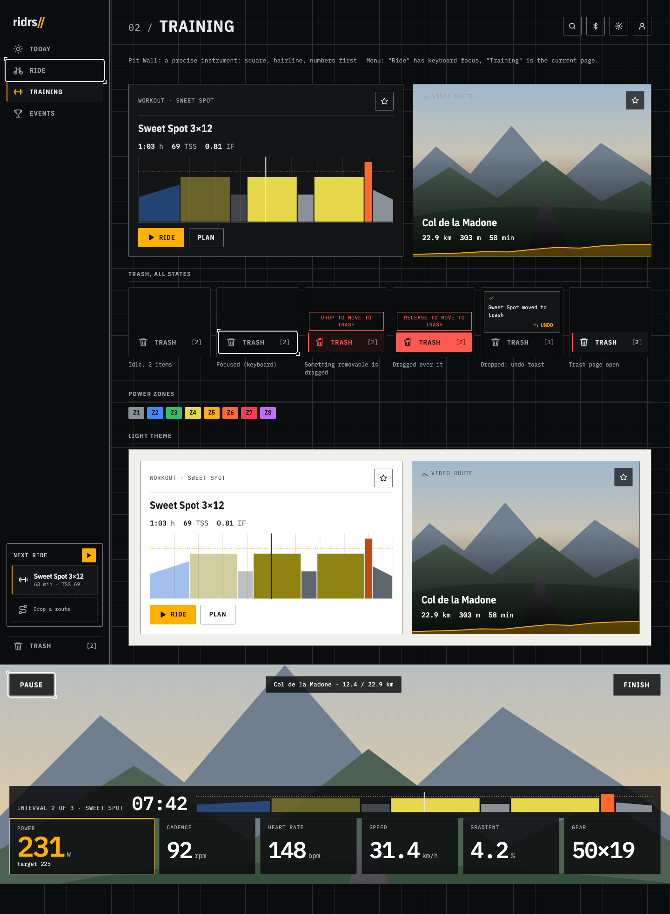

<!-- SPDX-License-Identifier: CC-BY-SA-4.0 -->

# Concept 3: Pit Wall

> **A precise instrument: square, hairline, numbers first.**

[`mockup.html`](mockup.html) (self-contained; fonts from Google Fonts for the mockup only).

## Idea and personality

This concept treats ridrs as a **measuring instrument**. The look takes its cues from timing screens and lab equipment: graphite surfaces on a faint 48 px grid, 1 px hairlines, a 2 px radius on everything, condensed capitals for names and a monospaced face for every number. There is **one signal colour**, amber, used for actions and for the one value that matters most at any moment (power against target). Everything else is greyscale, so the zone colours in the charts carry the colour.

- **Mood:** focused, quiet, exact. Data you can trust.
- **Suits:** structured-training riders, coaches, people who look at intervals.icu every day; the data-dense side of ridrs (calendar, editor, briefing, debriefing).
- **Inspirations (described, not copied):** motorsport timing walls, oscilloscopes and lab instruments, engineering drawings with title blocks, aircraft displays.

## How it resolves workouts versus rides

- **Neither aggressive nor soft: neutral.** Both catalogues use the same hairline-framed card with a 2 px radius. Pictures are framed like plates in a technical document, with the title and stats in the title block below the scrim.
- **Workouts get honesty, not drama.** Bars are square with a 1 px gap drawn in the background colour, over a 10 % time grid. The FTP line is amber dotted. Done steps are at 40 %. Nothing glows, and no fill is volt.
- **Rides get the same numbers treatment.** Distance, climb and duration are monospace in the same title block as TSS and IF. A route and a workout are two kinds of the same object.

## The trash, redesigned

The trash is **a row of the menu**, under a hairline, with the count in brackets: `TRASH [2]`.

| State | Look | Motion | Announcement |
|---|---|---|---|
| Idle | muted row, mono count `[2]` | none | "Trash, 2 items" |
| Hover | `surface` fill | 80 ms | – |
| Focus | white 2 px frame plus corner ticks 8 px outside | none | – |
| Armed | a 2 px red left rule, an 8 % red tint, open-lid icon; a bordered mono hint **above** it: `DROP TO MOVE TO TRASH` | 80 ms | – |
| Over | solid red row, black text | 0 ms (instant, like an instrument) | – |
| Dropped | the count flips to `[3]` in red; a log line toast bottom-left: `✓ Sweet Spot moved to trash   UNDO` | toast appears instantly, stays 6 s | `role="status"` |
| Refused | idle; the hint shows `NOT ACCEPTED` in muted if a known non-removable type is dragged | – | – |
| Current page | `surface` with a red 2 px left rule | – | `aria-current` |

## Tokens

### Colour

**Semantic roles:** `accent` amber = act and "key value", `info` blue = planned and links, `ok` green, `danger` red; `text`/`muted` in neutral greys. In this concept `warn` is the same amber as `accent`, so warnings always carry an icon and a word.

Contrast ratios are computed with the WCAG 2.x relative-luminance formula. The focus ring is always separated from fills by a gap in the page colour, so it is checked against `bg` and `surface`.

**Dark**

| Role | Token | Value |
|---|---|---|
| bg | `--ridrs-bg` | `#0b0c0d` |
| surface | `--ridrs-surface` | `#131517` |
| raised | `--ridrs-raised` | `#1b1e21` |
| line | `--ridrs-line` | `#2a2e33` |
| line-strong | `--ridrs-line-strong` | `#6b727b` |
| text | `--ridrs-text` | `#e9ebee` |
| muted | `--ridrs-muted` | `#9ba1a8` |
| accent | `--ridrs-accent` | `#ffb000` |
| accent-text | `--ridrs-accent-text` | `#0b0c0d` |
| accent-ink | `--ridrs-accent-ink` | `#ffb000` |
| info | `--ridrs-info` | `#5ab0ff` |
| ok | `--ridrs-ok` | `#3fd47a` |
| warn | `--ridrs-warn` | `#ffb000` |
| danger | `--ridrs-danger` | `#ff5a52` |
| focus | `--ridrs-focus` | `#ffffff` |

| Pair (dark) | Ratio | Needs | Result |
|---|---|---|---|
| text on bg | 16.4:1 | 4.5:1 | pass |
| text on surface | 15.3:1 | 4.5:1 | pass |
| muted on bg | 7.5:1 | 4.5:1 | pass |
| muted on surface | 7.0:1 | 4.5:1 | pass |
| muted on raised | 6.4:1 | 4.5:1 | pass |
| accent-text on accent | 10.7:1 | 4.5:1 | pass |
| accent-ink on bg | 10.7:1 | 4.5:1 | pass |
| accent-ink on surface | 10.0:1 | 4.5:1 | pass |
| info on bg | 8.5:1 | 3.0:1 | pass |
| ok on surface | 9.5:1 | 3.0:1 | pass |
| warn on surface | 10.0:1 | 3.0:1 | pass |
| danger on surface | 6.0:1 | 4.5:1 | pass |
| line-strong on surface | 3.8:1 | 3.0:1 | pass |
| focus on bg | 19.6:1 | 3.0:1 | pass |
| focus on surface | 18.3:1 | 3.0:1 | pass |

| Zone (dark) | Colour | vs bg | vs neighbour |
|---|---|---|---|
| Z1 | `#8a9199` | 6.1:1 | – |
| Z2 | `#3d8bfd` | 5.9:1 | 1.04 |
| Z3 | `#2fbf71` | 8.2:1 | 1.40 |
| Z4 | `#e6d84a` | 13.3:1 | 1.62 |
| Z5 | `#ffb000` | 10.7:1 | 1.25 |
| Z6 | `#ff6a2b` | 6.9:1 | 1.56 |
| Z7 | `#ff3b5c` | 5.6:1 | 1.22 |
| Z8 | `#c46bff` | 6.4:1 | 1.14 |

**Light**

| Role | Token | Value |
|---|---|---|
| bg | `--ridrs-bg` | `#efefec` |
| surface | `--ridrs-surface` | `#ffffff` |
| raised | `--ridrs-raised` | `#e6e6e2` |
| line | `--ridrs-line` | `#d2d2cc` |
| line-strong | `--ridrs-line-strong` | `#76766f` |
| text | `--ridrs-text` | `#111214` |
| muted | `--ridrs-muted` | `#52565c` |
| accent | `--ridrs-accent` | `#ffb000` |
| accent-text | `--ridrs-accent-text` | `#111214` |
| accent-ink | `--ridrs-accent-ink` | `#8a5a00` |
| info | `--ridrs-info` | `#0b62c4` |
| ok | `--ridrs-ok` | `#1a7f45` |
| warn | `--ridrs-warn` | `#8a5a00` |
| danger | `--ridrs-danger` | `#c3241c` |
| focus | `--ridrs-focus` | `#111214` |

| Pair (light) | Ratio | Needs | Result |
|---|---|---|---|
| text on bg | 16.3:1 | 4.5:1 | pass |
| text on surface | 18.7:1 | 4.5:1 | pass |
| muted on bg | 6.4:1 | 4.5:1 | pass |
| muted on surface | 7.4:1 | 4.5:1 | pass |
| muted on raised | 5.9:1 | 4.5:1 | pass |
| accent-text on accent | 10.2:1 | 4.5:1 | pass |
| accent-ink on bg | 5.1:1 | 4.5:1 | pass |
| accent-ink on surface | 5.9:1 | 4.5:1 | pass |
| info on bg | 5.1:1 | 3.0:1 | pass |
| ok on surface | 5.0:1 | 3.0:1 | pass |
| warn on surface | 5.9:1 | 3.0:1 | pass |
| danger on surface | 5.9:1 | 4.5:1 | pass |
| line-strong on surface | 4.6:1 | 3.0:1 | pass |
| focus on bg | 16.3:1 | 3.0:1 | pass |
| focus on surface | 18.7:1 | 3.0:1 | pass |

| Zone (light) | Colour | vs bg | vs neighbour |
|---|---|---|---|
| Z1 | `#5f666e` | 5.0:1 | – |
| Z2 | `#1f62d1` | 4.9:1 | 1.03 |
| Z3 | `#1d8a4f` | 3.8:1 | 1.29 |
| Z4 | `#8f8312` | 3.4:1 | 1.13 |
| Z5 | `#a86f00` | 3.7:1 | 1.10 |
| Z6 | `#c24a12` | 4.3:1 | 1.15 |
| Z7 | `#c71f41` | 4.9:1 | 1.16 |
| Z8 | `#8a3fc4` | 5.1:1 | 1.03 |

### Typography

| Role | Family (licence) | Size | Weight | Case |
|---|---|---|---|---|
| Page title | IBM Plex Sans Condensed (OFL-1.1) | 34, with a mono index `02 /` | 600 | upper, 0.04 em |
| Section head | IBM Plex Sans Condensed | 13 | 600 | upper, 0.12 em, with a hairline under |
| Card title, names | IBM Plex Sans Condensed | 22 | 600 | as written |
| Body | IBM Plex Sans (OFL-1.1) | 15/1.45 | 400–500 | sentence |
| Labels, eyebrows, units | IBM Plex Mono (OFL-1.1) | 11–12 | 400–500 | upper, 0.08–0.1 em |
| Every number | IBM Plex Mono | HUD 48, key 60, timer 40 | 500 | – |

Monospaced numbers make tabular alignment automatic. Scale: 11, 12, 13, 15, 18, 22, 34, 48, 60.

### Spacing

4 px base, dense: 2, 4, 8, 12, 16, 24, 32. Rows 40 px (44 px on the ride path), card padding 16–20, gutter 32.

### Shape: one rule

**2 px everywhere, 0 for full-bleed and lines.** That covers buttons, cards, inputs, tiles, chips and focus frames. Circles are used only for status dots.

### Elevation and borders

No shadows. Structure comes from hairlines: 1 px `line` inside cards (the title-block divider), 1 px `line-strong` around cards and controls. A 2–3 px coloured rule marks state (amber = current or key, red = trash, blue = planned). The page background carries a 48 px grid in `line`, which is off in light mode and off behind video.

### Icons

Lucide (ISC) at 1.5 px stroke, 20/16 px, always paired with a mono label in navigation.

### Motion

Almost none: 80 ms colour changes, no easing curves worth naming. Toasts and states appear instantly. **During a ride: nothing moves except data.**

### Focus (rule 12)

A **white 2 px frame**, 2 px outside the element, plus **8 px corner ticks** at the top-left and bottom-right 8 px further out, like crop marks. It works on any fill (white on graphite 17:1; the ticks stay visible even when the frame touches an amber or red fill). In light mode the frame is ink black. Selection never uses a frame; it uses a coloured left rule.

## Component rules

- **Buttons:** 2 px radius, 1 px `line-strong` border, condensed capitals with 0.08 em tracking. Primary is amber fill with black text. 40 px (56 on the ride path).
- **Cards:** a 1 px `line-strong` frame and a title block (eyebrow + icon button) separated by a 1 px `line`. Numbers in mono.
- **Lists:** 40 px rows, hairline dividers, the selected row with an amber left rule.
- **Menu:** condensed capitals, a 2 px amber left rule for the current entry.
- **Top bar:** square 40 px icon buttons with hairline borders; the page title with an index (`02 / TRAINING`).
- **Dialogs:** a square frame with a title bar like a window: title left, `ESC` hint and close right.
- **Form fields:** 2 px radius, hairline, label in mono capitals above, value in Plex Sans; numeric fields in mono with units right-aligned.
- **Chips:** square tags; selected = amber left rule plus text colour.
- **Workout chart:** square bars, 1 px gaps, a 10 % vertical grid, a dotted amber FTP line, done at 40 %; axis labels in mono 11 px.
- **Ride cards:** a picture plate with a dark scrim at the bottom, the title in condensed, stats in mono, the profile line in amber.
- **HUD metrics:** square tiles at 85 % graphite with hairlines; label in mono capitals 11 px; value in mono 48 px; the key metric in amber 60 px with an amber top rule; the target below it.
- **Trash and next ride:** as above. Empty slots are dashed hairline rectangles (dashes are acceptable here because every other line is solid and fine).
- **Empty states:** a mono line (`NO RIDES IN THE TRASH`) plus one sentence, no illustration.

## Screen by screen

- **Main menu:** a list of rows; the next ride is a bordered box with a filled slot (amber rule) and a dashed empty slot; a hairline; the trash row.
- **Workouts:** the calendar as a true table (days as columns, hairlines, mono dates). Entries are 2 px boxes with a blue (planned) or green (done) left rule and a mono line "61 min · 44 TSS".
- **Rides catalogue:** plates in a grid; a list view toggle (a table of routes with distance, climb and time) comes for free in this language.
- **Briefing:** a checklist table: each row has a status dot, a label and a value, ending with `START` (amber, full width, 56 px).
- **In-ride HUD:** the mockup's strip. Pause/Finish are square framed buttons with the white focus frame.
- **Debriefing:** a results sheet: totals in mono, time in zones as a horizontal stacked bar with mono percentages, splits per interval as a table.
- **Settings:** a two-column form (label column in mono, control column), like a configuration panel.

## Pros, cons and risks

**Pros**
- The best fit for data density (calendar, editor, debriefing) and the clearest numbers (mono, tabular).
- The simplest shape rule (2 px) and the easiest to enforce (one token, no exceptions).
- Neutral greys let the zone colours and the video do the colour work. Amber is unambiguous.
- No pseudo-element tricks for shape. The focus ticks are one `::after` that never fights with clipping.

**Cons**
- Cool and technical; it can feel like work. Casual riders may find it austere.
- The grid background and the condensed capitals can look busy on a small phone; the grid is off on compact.
- It drops volt and Chakra Petch (a brand change, as in concept 2).

**Risks**
- `warn` equals `accent`: every warning needs an icon and a word, and the lint can check that.
- Mono numbers at 60 px are wide. Six HUD tiles fit at 1280 pt; on compact the HUD shows three tiles and pages the rest.

**Effort:** medium-low (about 2 weeks). The rules are simple, and most of the work is removing decoration (glows, clip-paths, gradients).

**Migration path**
1. Token sheet (replacing `kinetic.tsx`) with one radius token `--ridrs-radius: 2px`, `--ridrs-line-strong`, `--ridrs-danger` and the light set. Fontsource `@fontsource/ibm-plex-sans`, `-condensed` and `-mono` (ADR per rule 2; OFL-1.1 needs maintainer approval).
2. `packages/ui-preview/src/style.ts`: replace every radius with the token, borders to hairlines, remove the teaser's glass and gradients except the scrim.
3. Calendar, next ride, menu and trash: remove `clip-path`, glows and volt fills.
4. HUD widgets: mono values, tiles on tokens.
5. A lint rule: no `border-radius` value other than `var(--ridrs-radius)`, `0` or `50%`.

**Rule 12 fit:** excellent. The frame plus ticks is unmistakable, works on every fill, and never resembles a selection (selections are left rules).

**Platforms:** works the same on both. On Android, square controls feel slightly foreign next to system dialogs (the file picker, permissions), which is acceptable for an instrument-style app.
