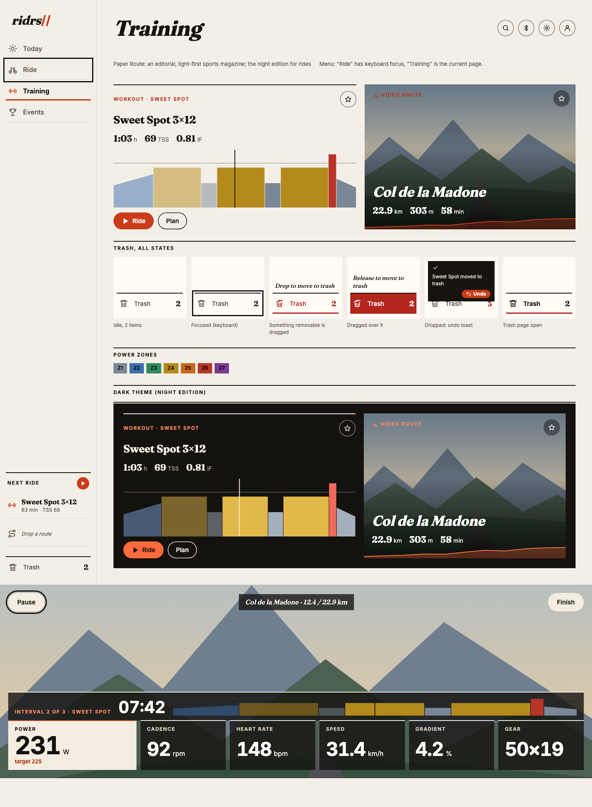

<!-- SPDX-License-Identifier: CC-BY-SA-4.0 -->

# Concept 4: Paper Route

> **An editorial, light-first sports magazine, with a night edition for the ride.**

[`mockup.html`](mockup.html) (self-contained; fonts from Google Fonts for the mockup only). The top shows the day edition (light, the default for this concept), the second row shows the night edition (dark).

## Idea and personality

Every indoor cycling app is dark and neon. This concept is **the opposite on purpose**: warm paper, ink-black type, a confident serif for titles, and one signal colour (a vermilion orange-red) as in a cycling magazine or a race programme. Structure comes from **typographic rules** (2 px ink lines above sections, 1 px rules between rows), not from boxes. Frames are square like printed pages. The only round things are actions (pills), so "round means press" becomes a rule anyone can learn in a minute.

The ride itself is the **night edition**: when the video or the world fills the screen, the HUD uses the dark tokens, and the app follows the system theme otherwise.

- **Mood:** literate, crafted, calm, with a dash of race-day poster.
- **Suits:** riders who use ridrs in a bright room or on a tablet by a window, people who read about their rides (debriefing, history), and a brand that wants to stand out.
- **Inspirations (described, not copied):** cycling magazines and race-programme layouts, vintage stage maps with their profile drawings, newspaper sports pages and their result tables.

## How it resolves workouts versus rides

- **Both are articles.** A workout card and a ride card share the same anatomy: an eyebrow in vermilion capitals, a serif title, facts with serif numbers and sans units, and a 2 px ink rule on top. The ride card is the same article with a photograph.
- **Workouts look like charts in a magazine:** square bars with 1 px paper-coloured gaps, a thin ink FTP rule, earthy zone colours (slate, cobalt, pine, ochre, burnt orange, brick, plum) that print well and stay apart for colour-blind readers.
- **Rides look like stage maps:** the profile in vermilion with a fine line.
- **No neon on either side.** Vermilion is for actions and the "your position" marker.

## The trash, redesigned

The trash is a **footnote at the bottom of the menu**: a 2 px ink rule above, the label, and the count as a serif numeral.

| State | Look | Motion | Announcement |
|---|---|---|---|
| Idle | ink rule above, muted label, serif count at the right | none | "Trash, 2 items" |
| Hover | the label goes to `text` | 120 ms | – |
| Focus | ink 3 px outline, offset 3 px | none | – |
| Armed | a 3 px danger underline, open-lid icon, an italic serif note above it: *Drop to move to trash* | 120 ms | – |
| Over | inverted: a danger block with white text | 80 ms | – |
| Dropped | a "correction slip" toast (an ink block with paper text) at the bottom: "Sweet Spot moved to trash" with a vermilion **Undo** pill; the count turns danger for 2 s | 160 ms slide | `role="status"` |
| Refused | idle | – | – |
| Current page | bold label with a danger underline | – | `aria-current` |

## Tokens

### Colour

**Semantic roles:** `accent` vermilion = act and "you", `info` cobalt = planned and links, `ok` pine, `warn` ochre, `danger` brick. In light mode, white text on `accent` reaches 5.1:1. In dark mode, the accent brightens to `#ff6b3d` with dark text.

Contrast ratios are computed with the WCAG 2.x relative-luminance formula. The focus ring is always separated from fills by a gap in the page colour, so it is checked against `bg` and `surface`.

**Dark**

| Role | Token | Value |
|---|---|---|
| bg | `--ridrs-bg` | `#14120f` |
| surface | `--ridrs-surface` | `#1d1a16` |
| raised | `--ridrs-raised` | `#27231d` |
| line | `--ridrs-line` | `#3a342b` |
| line-strong | `--ridrs-line-strong` | `#8c8373` |
| text | `--ridrs-text` | `#f3ede2` |
| muted | `--ridrs-muted` | `#b3a997` |
| accent | `--ridrs-accent` | `#ff6b3d` |
| accent-text | `--ridrs-accent-text` | `#1a0c06` |
| accent-ink | `--ridrs-accent-ink` | `#ff8a63` |
| info | `--ridrs-info` | `#8cb8ea` |
| ok | `--ridrs-ok` | `#7cc79a` |
| warn | `--ridrs-warn` | `#e7b453` |
| danger | `--ridrs-danger` | `#ff7a6e` |
| focus | `--ridrs-focus` | `#f3ede2` |

| Pair (dark) | Ratio | Needs | Result |
|---|---|---|---|
| text on bg | 16.0:1 | 4.5:1 | pass |
| text on surface | 14.9:1 | 4.5:1 | pass |
| muted on bg | 8.0:1 | 4.5:1 | pass |
| muted on surface | 7.5:1 | 4.5:1 | pass |
| muted on raised | 6.7:1 | 4.5:1 | pass |
| accent-text on accent | 6.8:1 | 4.5:1 | pass |
| accent-ink on bg | 8.1:1 | 4.5:1 | pass |
| accent-ink on surface | 7.5:1 | 4.5:1 | pass |
| info on bg | 9.0:1 | 3.0:1 | pass |
| ok on surface | 8.7:1 | 3.0:1 | pass |
| warn on surface | 9.1:1 | 3.0:1 | pass |
| danger on surface | 6.8:1 | 4.5:1 | pass |
| line-strong on surface | 4.6:1 | 3.0:1 | pass |
| focus on bg | 16.0:1 | 3.0:1 | pass |
| focus on surface | 14.9:1 | 3.0:1 | pass |

| Zone (dark) | Colour | vs bg | vs neighbour |
|---|---|---|---|
| Z1 | `#a3afbd` | 8.4:1 | – |
| Z2 | `#79a4dc` | 7.3:1 | 1.16 |
| Z3 | `#6cbf91` | 8.5:1 | 1.16 |
| Z4 | `#e3b84a` | 10.0:1 | 1.18 |
| Z5 | `#f08a46` | 7.5:1 | 1.33 |
| Z6 | `#ef6a5c` | 6.1:1 | 1.22 |
| Z7 | `#b97fcf` | 6.2:1 | 1.02 |

**Light**

| Role | Token | Value |
|---|---|---|
| bg | `--ridrs-bg` | `#f4efe6` |
| surface | `--ridrs-surface` | `#fffcf6` |
| raised | `--ridrs-raised` | `#ebe4d7` |
| line | `--ridrs-line` | `#ddd3c2` |
| line-strong | `--ridrs-line-strong` | `#8a8070` |
| text | `--ridrs-text` | `#17140f` |
| muted | `--ridrs-muted` | `#5b5449` |
| accent | `--ridrs-accent` | `#c93b19` |
| accent-text | `--ridrs-accent-text` | `#ffffff` |
| accent-ink | `--ridrs-accent-ink` | `#b5351a` |
| info | `--ridrs-info` | `#285f9e` |
| ok | `--ridrs-ok` | `#2f7a4d` |
| warn | `--ridrs-warn` | `#8f5d06` |
| danger | `--ridrs-danger` | `#b3261e` |
| focus | `--ridrs-focus` | `#17140f` |

| Pair (light) | Ratio | Needs | Result |
|---|---|---|---|
| text on bg | 16.0:1 | 4.5:1 | pass |
| text on surface | 17.9:1 | 4.5:1 | pass |
| muted on bg | 6.5:1 | 4.5:1 | pass |
| muted on surface | 7.3:1 | 4.5:1 | pass |
| muted on raised | 5.9:1 | 4.5:1 | pass |
| accent-text on accent | 5.1:1 | 4.5:1 | pass |
| accent-ink on bg | 5.3:1 | 4.5:1 | pass |
| accent-ink on surface | 5.9:1 | 4.5:1 | pass |
| info on bg | 5.7:1 | 3.0:1 | pass |
| ok on surface | 5.1:1 | 3.0:1 | pass |
| warn on surface | 5.5:1 | 3.0:1 | pass |
| danger on surface | 6.4:1 | 4.5:1 | pass |
| line-strong on surface | 3.8:1 | 3.0:1 | pass |
| focus on bg | 16.0:1 | 3.0:1 | pass |
| focus on surface | 17.9:1 | 3.0:1 | pass |

| Zone (light) | Colour | vs bg | vs neighbour |
|---|---|---|---|
| Z1 | `#7a8796` | 3.2:1 | – |
| Z2 | `#3b6fb0` | 4.5:1 | 1.40 |
| Z3 | `#2f8a5e` | 3.7:1 | 1.20 |
| Z4 | `#b58a1c` | 2.8:1 | 1.35 |
| Z5 | `#c9661f` | 3.4:1 | 1.22 |
| Z6 | `#b8352a` | 5.1:1 | 1.51 |
| Z7 | `#7a3a8f` | 6.5:1 | 1.27 |

### Typography

| Role | Family (licence) | Size | Weight / style |
|---|---|---|---|
| Page title | Fraunces (OFL-1.1, variable, optical size) | 52/1.0 | 700 italic |
| Card title | Fraunces | 26 (34 over pictures) | 700 |
| Section head | Inter (OFL-1.1) | 12 | 700, upper, 0.14 em, a 2 px ink rule above |
| Body | Inter | 15/1.5 | 400–500 |
| Eyebrow | Inter | 12 | 700, upper, 0.14 em, vermilion |
| Facts numbers (catalogue) | Fraunces | 22 | 700 |
| HUD and every changing number | Inter, tabular figures (`tnum`, available in Inter) | 46, key 60 | 700 |

Serif numbers are for reading (catalogues, the debriefing). Changing numbers (HUD, timers) are always Inter tabular, because a serif at 2 m with changing digits is harder to read. Scale: 12, 13, 15, 17, 22, 26, 34, 52, 60.

### Spacing

8 px rhythm with a 4 px half step: 4, 8, 12, 16, 24, 32, 48. Generous gutters (40), rules between blocks instead of gaps inside cards.

### Shape: one rule

**Paper is square, actions are round.** Cards, pictures, tiles, dialogs, the menu and calendar cells use 0 radius. Buttons, chips, the play button, toggles and HUD buttons are pills (999 px). Inputs get 4 px (the one exception, so they read as fields, not as buttons).

### Elevation and borders

No shadows on paper. Rules: 2 px `text` above sections and cards (the "headline rule"), 1 px `line` between rows, a 6 px double rule to separate big zones. Toasts and dialogs are ink blocks (inverted), not shadows.

### Icons

Lucide (ISC) at 1.75 px, 22/18 px, ink coloured, vermilion when active.

### Motion

Restrained: 120–160 ms fades and 8 px slides, like turning a page. **During a ride:** none.

### Focus (rule 12)

An **ink outline** (3 px, offset 3 px; `#17140f` in light, `#f3ede2` in dark), so focus looks like an editor's mark around the element. Ink is the text colour, never a fill of anything selectable. Selection uses a vermilion underline or a vermilion icon, never an outline.

## Component rules

- **Buttons:** pills; primary vermilion with white text (light) or dark text (dark); secondary is an ink outline pill (1.5 px); text buttons are underlined.
- **Cards:** no box: a 2 px rule on top, then eyebrow, title, facts and actions. The picture card is a full-bleed photograph with the title over a bottom scrim.
- **Lists:** rows separated by 1 px rules, 52 px, the selected row with a vermilion bar on the left.
- **Menu:** text entries with rules between them; current = bold with a vermilion 3 px underline.
- **Top bar:** round outline icon buttons (pills are "press").
- **Dialogs:** a square paper sheet with a 2 px top rule and a serif title; close is a round outline button.
- **Form fields:** 4 px, 1 px `line-strong`, label above in Inter 13/600.
- **Chips:** pills; selected = ink fill with paper text.
- **Workout chart:** square bars, 1 px gaps, earthy zones, a solid thin ink FTP line at 50 %, done at 50 %, the position as an ink line.
- **Ride cards:** a photograph, a serif italic title over the scrim, the profile in vermilion.
- **HUD metrics:** night-edition tiles (ink at 80 %) with a 2 px paper rule on top, label in Inter capitals, value 46 px Inter tabular. The key metric is a **paper tile** (light on video) with a vermilion rule and the target in brick.
- **Trash and next ride:** as above; the next ride is a mini article with a vermilion play pill; the empty slot is italic muted text ("Drop a route").
- **Empty states:** a short italic serif sentence and a pill action, like an editor's note.

## Screen by screen

- **Main menu:** the wordmark in italic serif with vermilion slashes; text entries; the next ride article; the trash footnote.
- **Workouts:** the calendar as a printed week: columns with rules, serif dates, entries as small articles (planned = cobalt bar, done = pine check). The library as a magazine grid.
- **Rides catalogue:** a photo grid with serif italic titles: the most magazine-like screen.
- **Briefing:** reads like a race programme: route (profile in vermilion), workout (chart), bike and devices, with a ruled checklist, and "Start" as a large vermilion pill.
- **In-ride HUD:** the night edition: dark tiles over video, a paper key tile.
- **Debriefing:** a results page with a big serif headline ("61 minutes on the Madone"), a result table and a zone bar, then Save.
- **Settings:** a ruled form; section heads in small capitals with rules.

## Pros, cons and risks

**Pros**
- Distinctive in a market of dark neon apps, and memorable.
- The best readability in bright rooms. Ink on paper is the most legible combination there is, at 16:1.
- A simple, learnable shape rule ("round means press").
- The serif plus earthy palette carries the route-and-story side (rides, history) very well.

**Cons**
- Light-first is unusual for indoor training (dark rooms, TV screens). The night edition must be equally finished, so the work is two first-class themes.
- A serif can feel less "sporty"; some riders will find it too calm.
- The biggest brand departure of the five.

**Risks**
- A large paper surface on a TV in a dark room is glaring: default to the system theme and switch to night during a ride.
- Fraunces is a variable font with optical sizes; bundle only the needed instance range to keep the size down.

**Effort:** high (3–4 weeks). It needs two complete themes, new type, a recut of every card as "article", and a new HUD key tile.

**Migration path**
1. A token sheet with light and dark sets switched by `prefers-color-scheme` and a setting. The tokens are the same names as today plus `--ridrs-rule`, `--ridrs-radius-action` and `--ridrs-radius-field`.
2. Fontsource `@fontsource-variable/fraunces` and `@fontsource/inter` (ADR; OFL-1.1 approval).
3. `ui-preview`: cards without boxes, rules, pills for actions only.
4. All plugins: remove the dark-only assumptions (hard-coded white text, dark scrims on non-photo cards). The audit counted 34 raw `#fff`.
5. HUD: dark tokens forced inside the activity screen (`data-theme="dark"` on its root).

**Rule 12 fit:** good. The ink ring is strong on paper and on the night edition. The danger "over" state inverts, which stays distinct from the outline.

**Platforms:** a light theme matches Android's default and macOS light mode; the night edition matches dark mode. Both platforms render Fraunces and Inter identically from bundled files.
