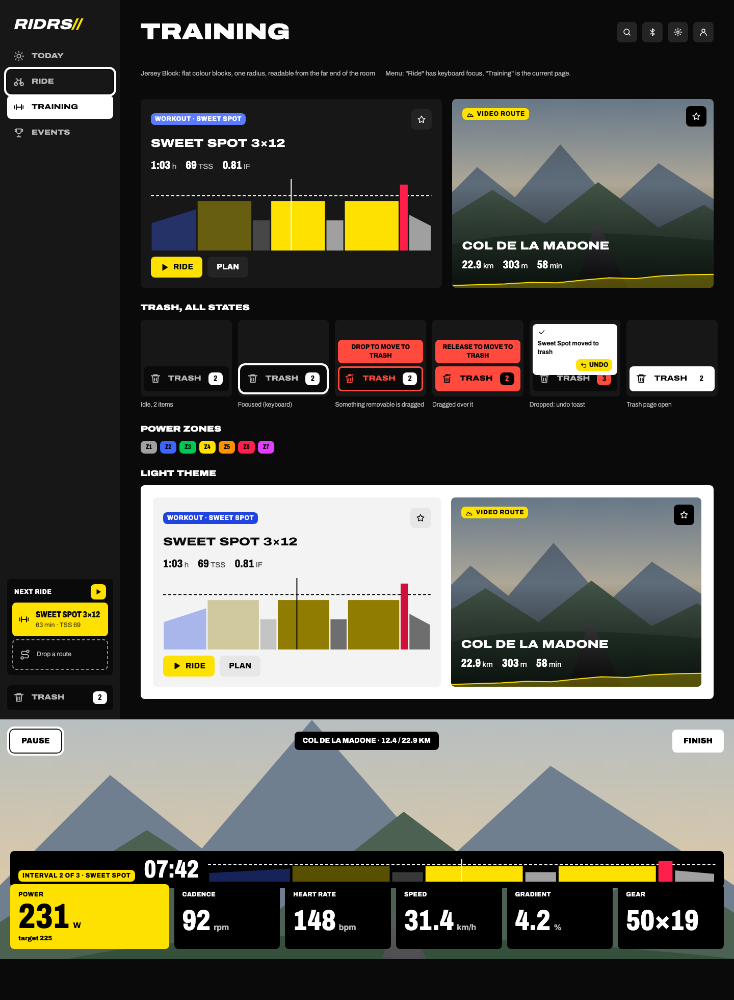

<!-- SPDX-License-Identifier: CC-BY-SA-4.0 -->

# Concept 5: Jersey Block

> **Flat colour blocks, one radius, readable from the far end of the room.**

[`mockup.html`](mockup.html) (self-contained; fonts from Google Fonts for the mockup only).

## Idea and personality

This concept is designed for **2–3 m distance and a sweaty rider**. It is built from solid, flat blocks of colour like a team jersey or a race number: black, white, a strong yellow for actions and an electric blue for information. It has **one radius (8 px) for everything**, no shadows, no glows, no gradients except the picture scrim, and heavy, wide capitals for headings with condensed heavy numerals. The focused element gets a thick white "sticker" outline. Every state is a change of block colour, which is the most legible signal at a distance.

- **Mood:** bold, energetic, direct; race day and a stadium scoreboard.
- **Suits:** riders who train hard and want the screen readable without glasses at TV distance, group or family setups, the controller-only ride path.
- **Inspirations (described, not copied):** team jerseys and race numbers, stadium scoreboards, sports-broadcast lower thirds, Swiss poster typography.

## How it resolves workouts versus rides

- **One block, one radius.** Workouts, rides, events and settings are all 8 px blocks. Pictures are 8 px blocks too.
- **Workouts get stronger, rides get stronger, both get clearer.** Aggression in today's calendar comes from glows and chamfers. Here intensity comes only from the zone colours as flat bars (square, 3 px gaps). The rest is calm black and white.
- **Labels are tags.** Eyebrows are small filled tags (blue for information, yellow on pictures), so "VIDEO ROUTE" on a ride and "WORKOUT · SWEET SPOT" on a workout are the same object.

## The trash, redesigned

The trash is **a block in the menu like every entry**, with a white count tag.

| State | Look | Motion | Announcement |
|---|---|---|---|
| Idle | a black block, muted label in wide capitals, a white count tag | none | "Trash, 2 items" |
| Hover | `raised` fill | 100 ms | – |
| Focus | 4 px white outline with a 2 px black gap | none | – |
| Armed | 3 px red inner border, open-lid icon, a red tag above it: `DROP TO MOVE TO TRASH` | 100 ms | – |
| Over | solid red block, black text, the count tag inverts | 60 ms | – |
| Dropped | the count tag turns red with the new number; a white toast block at the bottom: "Sweet Spot moved to trash" with a yellow `UNDO` tag-button | 120 ms | `role="status"` |
| Refused | idle | – | – |
| Current page | a white block with black text (the same as every current entry) | – | `aria-current` |

## Tokens

### Colour

**Semantic roles:** `accent` yellow = act (with black text), `info` electric blue = information tags, planned and links, `ok` green, `warn` orange, `danger` red (with black text), `text` white, `bg` black. Current/selected = **inverted block** (white with black text), which needs no extra colour.

Contrast ratios are computed with the WCAG 2.x relative-luminance formula. The focus ring is always separated from fills by a gap in the page colour, so it is checked against `bg` and `surface`.

**Dark**

| Role | Token | Value |
|---|---|---|
| bg | `--ridrs-bg` | `#0a0a0a` |
| surface | `--ridrs-surface` | `#171717` |
| raised | `--ridrs-raised` | `#242424` |
| line | `--ridrs-line` | `#333333` |
| line-strong | `--ridrs-line-strong` | `#8a8a8a` |
| text | `--ridrs-text` | `#ffffff` |
| muted | `--ridrs-muted` | `#b8b8b8` |
| accent | `--ridrs-accent` | `#ffe100` |
| accent-text | `--ridrs-accent-text` | `#0a0a0a` |
| accent-ink | `--ridrs-accent-ink` | `#ffe100` |
| info | `--ridrs-info` | `#5c7cff` |
| ok | `--ridrs-ok` | `#00d26a` |
| warn | `--ridrs-warn` | `#ff9a1f` |
| danger | `--ridrs-danger` | `#ff4a3d` |
| focus | `--ridrs-focus` | `#ffffff` |

| Pair (dark) | Ratio | Needs | Result |
|---|---|---|---|
| text on bg | 19.8:1 | 4.5:1 | pass |
| text on surface | 17.9:1 | 4.5:1 | pass |
| muted on bg | 10.0:1 | 4.5:1 | pass |
| muted on surface | 9.0:1 | 4.5:1 | pass |
| muted on raised | 7.8:1 | 4.5:1 | pass |
| accent-text on accent | 15.1:1 | 4.5:1 | pass |
| accent-ink on bg | 15.1:1 | 4.5:1 | pass |
| accent-ink on surface | 13.7:1 | 4.5:1 | pass |
| info on bg | 5.5:1 | 3.0:1 | pass |
| ok on surface | 8.9:1 | 3.0:1 | pass |
| warn on surface | 8.4:1 | 3.0:1 | pass |
| danger on surface | 5.4:1 | 4.5:1 | pass |
| line-strong on surface | 5.2:1 | 3.0:1 | pass |
| focus on bg | 19.8:1 | 3.0:1 | pass |
| focus on surface | 17.9:1 | 3.0:1 | pass |

| Zone (dark) | Colour | vs bg | vs neighbour |
|---|---|---|---|
| Z1 | `#a0a0a0` | 7.6:1 | – |
| Z2 | `#3d64ff` | 4.2:1 | 1.80 |
| Z3 | `#00c853` | 8.8:1 | 2.10 |
| Z4 | `#ffe100` | 15.1:1 | 1.71 |
| Z5 | `#ff9100` | 8.8:1 | 1.72 |
| Z6 | `#ff1f4b` | 5.2:1 | 1.68 |
| Z7 | `#e040fb` | 5.9:1 | 1.13 |

**Light**

| Role | Token | Value |
|---|---|---|
| bg | `--ridrs-bg` | `#ffffff` |
| surface | `--ridrs-surface` | `#f3f3f3` |
| raised | `--ridrs-raised` | `#e7e7e7` |
| line | `--ridrs-line` | `#d6d6d6` |
| line-strong | `--ridrs-line-strong` | `#757575` |
| text | `--ridrs-text` | `#0a0a0a` |
| muted | `--ridrs-muted` | `#4d4d4d` |
| accent | `--ridrs-accent` | `#ffe100` |
| accent-text | `--ridrs-accent-text` | `#0a0a0a` |
| accent-ink | `--ridrs-accent-ink` | `#1f44e0` |
| info | `--ridrs-info` | `#1f44e0` |
| ok | `--ridrs-ok` | `#00803f` |
| warn | `--ridrs-warn` | `#a35c00` |
| danger | `--ridrs-danger` | `#c81e12` |
| focus | `--ridrs-focus` | `#0a0a0a` |

| Pair (light) | Ratio | Needs | Result |
|---|---|---|---|
| text on bg | 19.8:1 | 4.5:1 | pass |
| text on surface | 17.8:1 | 4.5:1 | pass |
| muted on bg | 8.5:1 | 4.5:1 | pass |
| muted on surface | 7.6:1 | 4.5:1 | pass |
| muted on raised | 6.8:1 | 4.5:1 | pass |
| accent-text on accent | 15.1:1 | 4.5:1 | pass |
| accent-ink on bg | 7.1:1 | 4.5:1 | pass |
| accent-ink on surface | 6.4:1 | 4.5:1 | pass |
| info on bg | 7.1:1 | 3.0:1 | pass |
| ok on surface | 4.5:1 | 3.0:1 | pass |
| warn on surface | 4.6:1 | 3.0:1 | pass |
| danger on surface | 5.2:1 | 4.5:1 | pass |
| line-strong on surface | 4.2:1 | 3.0:1 | pass |
| focus on bg | 19.8:1 | 3.0:1 | pass |
| focus on surface | 17.8:1 | 3.0:1 | pass |

| Zone (light) | Colour | vs bg | vs neighbour |
|---|---|---|---|
| Z1 | `#6e6e6e` | 5.1:1 | – |
| Z2 | `#1f44e0` | 7.1:1 | 1.39 |
| Z3 | `#00873a` | 4.6:1 | 1.53 |
| Z4 | `#8f7c00` | 4.2:1 | 1.12 |
| Z5 | `#b85f00` | 4.5:1 | 1.08 |
| Z6 | `#d0103a` | 5.5:1 | 1.22 |
| Z7 | `#9c1fb5` | 6.4:1 | 1.16 |

**Known conflict:** zone 4 (threshold yellow) is the same yellow as the action colour. In charts that is acceptable (charts are not pressable), but a yellow bar right beside a yellow "Ride" button competes. Option: shift zone 4 to `#c6f000` (a yellow-green); it needs a colour-blind check against zones 3 and 5.

### Typography

| Role | Family (licence) | Size | Width / weight | Case |
|---|---|---|---|---|
| Page title | Archivo (OFL-1.1, variable width 62–125) | 44 | 125 % / 900 | upper |
| Card and section titles | Archivo | 16–22 | 125 % / 800 | upper |
| Body | Archivo | 15/1.45 | 100 % / 400–500 | sentence |
| Tags (eyebrows) | Archivo | 12 | 100 % / 800 | upper, filled tag |
| Numbers | Archivo, tabular figures | HUD 56, key 68, timer 48 | 75 % / 800 | – |

One variable family covers wide headings, normal text and condensed numbers, all from a single file. Condensed heavy numerals fit big values into narrow tiles. Scale: 12, 14, 15, 16, 22, 28, 44, 56, 68. Archivo's `tnum` must be checked in the bundled file.

### Spacing

8 px base: 4 (inside tags), 8, 12, 16, 24, 32, 48. Card padding 20, gutters 24–32.

### Shape: one rule

**8 px on everything, 0 on full-bleed.** That covers buttons, cards, pictures, tags, inputs, HUD tiles, toasts, dialogs and the trash. No pills and no circles, except status dots.

### Elevation and borders

None. Depth is colour: `bg` black → `surface` → `raised`. Borders appear only as state (3 px red inner border = armed) and as the 2 px dashed outline of empty drop slots.

### Icons

Lucide (ISC) at 2.25 px stroke (heavier, to match the type), 22/18 px.

### Motion

Snappy: 60–120 ms colour swaps, no easing flourishes, no movement except toasts (120 ms). **During a ride:** nothing animates.

### Focus (rule 12)

The **sticker outline**: a 4 px `--ridrs-focus` (white in dark, black in light) outline with a 2 px gap in the page colour (`box-shadow: 0 0 0 2px var(--ridrs-bg)` under a 2 px offset). It is the thickest ring of the five concepts and visible from across a room. It reads on yellow and red blocks because of the gap. Current entries are inverted blocks, never outlined, so focus and current cannot be confused.

## Component rules

- **Buttons:** 8 px blocks, 48 px tall (60 on the ride path), wide-ish capitals 800. Primary is yellow with black text, secondary `raised`, destructive red with black text (only inside a confirmation).
- **Cards:** 8 px `surface` blocks, a filled tag, a wide title, condensed numbers.
- **Lists:** 8 px row blocks with 4 px gaps between them (blocks, not lines); current = inverted.
- **Menu:** blocks; current = white block, black text.
- **Top bar:** 40 px square 8 px blocks.
- **Dialogs:** an 8 px `surface` block on a 75 % black scrim, title 28/900 wide.
- **Form fields:** 8 px `raised` blocks, no border, a 3 px yellow inner edge at the bottom when editing, label above in tag style.
- **Chips:** 8 px tags; selected = inverted.
- **Workout chart:** flat square bars with 3 px gaps, a 2 px dashed white FTP line, done at 35 %, the position as a 2 px white line.
- **Ride cards:** an 8 px picture block, a yellow tag, the title in wide capitals, the profile line in yellow.
- **HUD metrics:** pure black 8 px tiles (100 % opaque, the strongest contrast over any video), white labels in capitals, values 56 px condensed; the key metric is a **yellow block with black numbers at 68 px**.
- **Trash and next ride:** as above. A filled next-ride slot is a yellow block (it is pressable: it starts the ride); the empty slot is a dashed outline.
- **Empty states:** one big muted icon, a wide capital line and a yellow button.

## Screen by screen

- **Main menu:** blocks top to bottom; the next ride box at the bottom with its yellow play block; the trash block.
- **Workouts:** the calendar as a grid of day blocks; entries as blocks in their state colour (planned = blue tag strip, done = white block with a check); today = yellow date tag.
- **Rides catalogue:** big picture blocks, yellow tags, wide titles.
- **Briefing:** large blocks per step, a status tag on each, and "START" as a full-width yellow 60 px block.
- **In-ride HUD:** the mockup strip: black tiles, a yellow key tile, the interval bar on black.
- **Debriefing:** a scoreboard: big condensed totals in blocks, a zone bar, and Save as a yellow block.
- **Settings:** block rows with inverted selection.

## Pros, cons and risks

**Pros**
- **The best readability at distance** of the five: solid opaque HUD tiles, 56–68 px condensed numbers, and the thickest focus outline.
- The simplest possible shape rule (8 px) and no shadows. Easy to enforce and fast to render.
- Strong and sporty without neon or glows; the energy comes from flat colour.
- One variable font file for everything.

**Cons**
- Loud. Large yellow and white blocks can tire in a long, calm endurance ride or in a dark room.
- Opaque black HUD tiles hide more of the video than glass does.
- A brand change (no volt, no Chakra Petch); yellow and blue are common sports colours, so the identity relies on the wordmark and the slashes.

**Risks**
- The zone 4 / accent overlap (see the colour section).
- Wide capitals take room; long German labels ("Trainingsplan", "Geräteverbindung") need 75–100 % width on narrow screens. The variable width axis allows this.

**Effort:** medium (2–3 weeks). The token swap and flat restyle are straightforward; the HUD gets a fixed layout; every plugin loses its gradients and glows.

**Migration path**
1. Token sheet (replacing `kinetic.tsx`): one radius `--ridrs-radius: 8px`, colours, the light set, focus tokens. Fontsource `@fontsource-variable/archivo` with the width axis (ADR; OFL-1.1 approval).
2. `ui-preview`: remove gradients and glass, tags for classifiers, inverted selection.
3. Menu, next ride, trash and calendar: blocks, inverted current, no `clip-path`.
4. HUD widgets: opaque tiles and condensed numerals.
5. Lint: no `box-shadow` except the focus gap, no `linear-gradient` outside picture scrims.

**Rule 12 fit:** the strongest. Focus is the thickest and highest-contrast mark, and selection is an inversion that cannot be mistaken for focus.

**Platforms:** works on both. On Android, solid blocks and 8 px corners sit well next to Material components; on macOS the look is deliberately un-native, like a game or a broadcast overlay.
