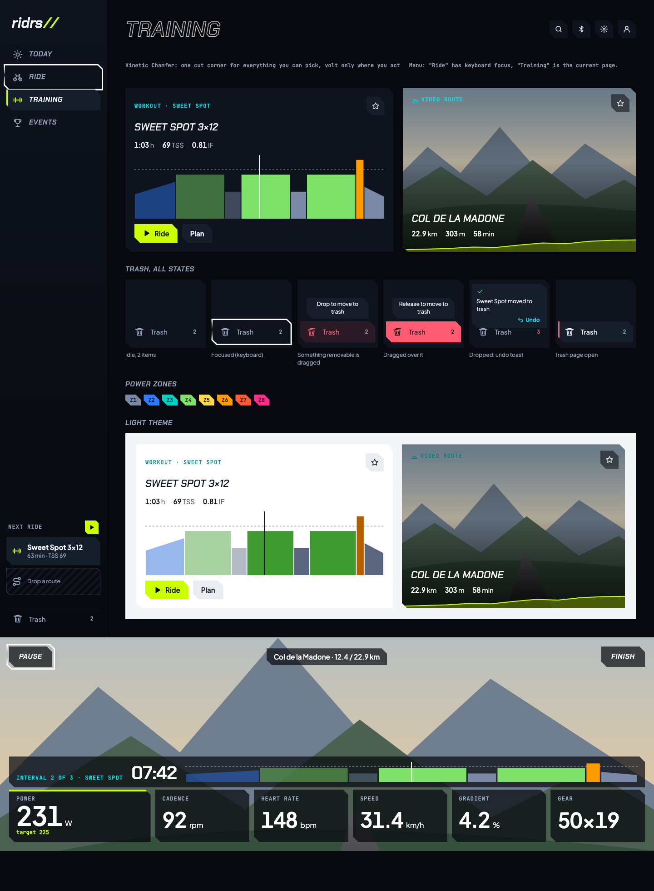
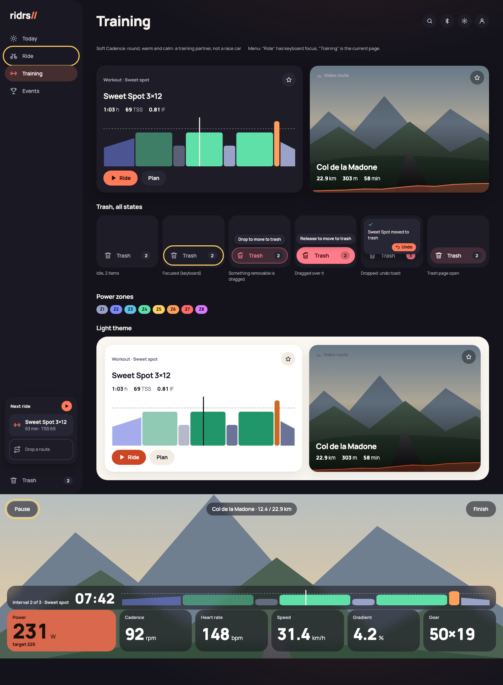
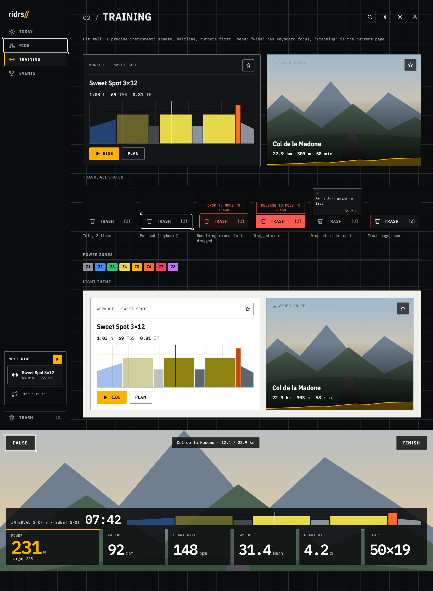
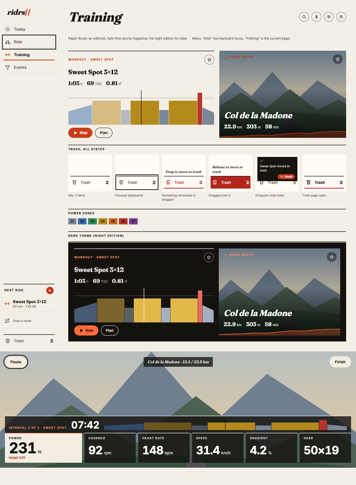
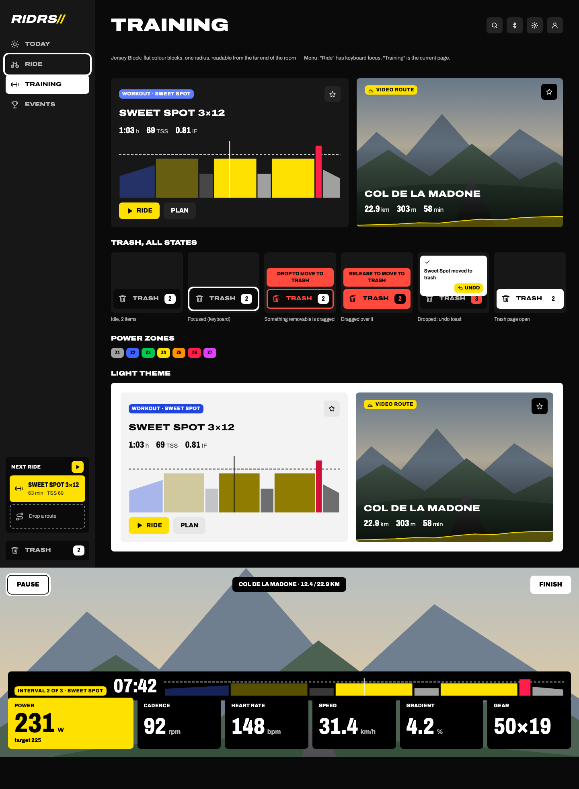

<!-- SPDX-License-Identifier: CC-BY-SA-4.0 -->

# Five Design Concepts for ridrs

Five unified design languages for the whole app, written in answer to the [design assessment](../assessment/README.md). Each folder has a detailed draft (`README.md`), a self-contained mockup (`mockup.html`) and its rendering (`mockup.png`). Every mockup shows the same content: the main menu with the next ride and the trash, a workout card with its interval chart, a ride card, the trash in all six states, the power zones, the second theme and the in-ride HUD strip.

| | | |
|---|---|---|
|  **1 Kinetic Chamfer** |  **2 Soft Cadence** |  **3 Pit Wall** |
|  **4 Paper Route** |  **5 Jersey Block** | |

## Comparison

| | 1 Kinetic Chamfer | 2 Soft Cadence | 3 Pit Wall | 4 Paper Route | 5 Jersey Block |
|---|---|---|---|---|---|
| **Personality** | fast, technical, the current brand finished | warm, calm, encouraging | exact, quiet, instrument | editorial, crafted, light | bold, flat, scoreboard |
| **Shape rule** | pickable things chamfered (6/8/14 px), containers square | radius grows with size: pill / 12 / 16 / 24 / 32 | 2 px everywhere | paper square, actions pill, fields 4 px | 8 px everywhere |
| **Palette** | near-black, volt only for actions, cyan info | aubergine-black, coral, sunflower focus, mint | graphite greys, one amber signal | paper and ink, vermilion, earthy zones | black/white, yellow actions, electric blue |
| **Type (all OFL-1.1)** | Chakra Petch, Plus Jakarta Sans, JetBrains Mono (as today) | Manrope | IBM Plex Sans, Plex Sans Condensed, Plex Mono | Fraunces, Inter | Archivo (variable width) |
| **Main theme** | dark (+ light) | dark (+ light) | dark (+ light) | **light** (+ night edition) | dark (+ light) |
| **Focus mark** | chamfered white ring with gap | sunflower ring | white frame + corner ticks | ink outline | 4 px sticker outline with gap |
| **Workouts vs rides** | same chamfered card, no glow, volt only for buttons | rides' softness for all, rounded chart bars | neutral hairline cards, numbers in mono for both | both are "articles", chart vs stage map | same 8 px block, intensity only in zone bars |
| **Trash** | normal entry under a hairline; danger tint, then fill; toast with Undo | pill; red pool, then solid with bump; toast with Undo | row `TRASH [2]`; red rule, then fill; log-line toast | footnote under an ink rule; underline, then inverted; slip toast | block; red border, then solid; white toast block |
| **Readability at 2–3 m** | good | good (glass tiles weaker on bright video) | very good (mono) | good on HUD, glare risk on paper | **best** (opaque tiles, 56–68 px condensed) |
| **Brand continuity** | **high** | low | low | lowest | low–medium (wordmark only) |
| **Effort** | medium (2–3 wk) | medium (2–3 wk) | medium-low (~2 wk) | high (3–4 wk) | medium (2–3 wk) |
| **Main risk** | pseudo-element technique on every component | coral close to danger; blur cost on Android | austere; `warn` = `accent` | two first-class themes; glare in dark rooms | zone 4 = action yellow; loud for long rides |
| **Rule 12 (focus)** | very good (once drawn outside the clip) | good (needs a halo over video) | excellent | good | excellent |

All five fix the four structural problems found in the assessment in the same way, whatever the look:

1. **One token sheet** replaces the class-name font layer and the three fallback palettes. Every token that plugins use (`--ridrs-danger`, `--ridrs-line-strong`, radii, font roles, focus) is defined. There is one light set, and a lint check forbids raw hex in plugin CSS.
2. **The ride gets designed.** The activity screen and the `ui-widget-*` tiles move from inline styles to tokens, with tabular figures, the app's focus ring on Pause/Finish, and the debug panel behind a developer setting.
3. **The trash becomes an entry of the menu** with complete states (idle, hover, focus, armed, over, dropped with Undo toast, refused, current), its hint inside the menu, "move to trash" wording, and a live-region announcement.
4. **Selected is never shown as a ring, and a ring is never clipped.** That ends the invisible focus on the current menu entry and on calendar entries.

## Recommendation

**Adopt concept 1, Kinetic Chamfer, as the base, and take the HUD from concept 5 and the data-screen details from concept 3.**

Reasoning:

- **The complaint is about mixes and missing polish, not about the brand.** ADR 0074 chose Kinetic as "the one and only theme" a week ago, and the ridrs.app page uses it. Concept 1 keeps the brand assets and fonts and removes exactly what the maintainer objects to: the rounded-versus-angular split (one shape rule), the aggression (glows and volt fills removed, volt kept for actions), and the half-done trash (a real entry with all states). It is also the only concept whose migration does not first need a brand decision.
- **It fixes the rule-12 bug at its root** (fills on `::before`, the ring on `::after`), a technique the other angular parts of the app need anyway.
- **Its weakest point is the ride at distance,** where Jersey Block is strongest. The HUD is a separate surface over video and can carry its own, stricter rules without breaking the language: opaque near-black chamfered tiles (instead of 74 % translucent), condensed heavy numerals at 56–68 px, and a 4 px focus outline with a gap. Chakra Petch upright is already a condensed-feeling face, so the HUD can use it for numbers if Plus Jakarta Sans's tabular figures disappoint.
- **The data screens benefit from Pit Wall's discipline:** mono numbers in the calendar and the editor, a hairline table for the month view, and "warnings always have an icon and a word". These fit inside the chamfer language without a new look.

Order of work (each step is shippable on its own):

1. Token sheet, the shared chamfer and focus CSS, and an ADR "Kinetic, finished" that supersedes the font layer of ADR 0074 (2–3 days).
2. Menu, next ride and trash with all states and the Undo toast (2 days). This answers the most visible part of the complaint first.
3. `@ridrs/ui-preview` cards, buttons and chips; the calendar without glows; the chart ramp (1 week).
4. HUD and activity screen (3–4 days).
5. The remaining old-palette plugins (devices, briefing, debriefing, training plan, workout details/editor, garage), the light theme, and the lint rule (1 week).

## Possible hybrids

- **Chamfer + Block HUD** (the recommendation): the brand everywhere, maximum legibility on the ride.
- **Chamfer + Paper Route light theme:** concept 1's dark theme with concept 4's paper-and-ink palette as its light mode, for daytime and phone use, keeping chamfers and Chakra Petch. This gives a light theme with real character instead of an inverted dark one.
- **Soft Cadence shell + Pit Wall data:** if the brand is allowed to change towards approachability, use the rounded warm shell for navigation and catalogues and Plex Mono numbers with hairline tables for the calendar, editor and debriefing. Softness where people browse, precision where they analyse.
- **Pit Wall + Jersey Block HUD:** for a pure training-tool positioning: square, quiet screens, and a loud, opaque HUD.

## Notes on the mockups

- The mockups are static HTML: no app code was changed. They use Google Fonts links for convenience. The app must bundle fonts through Fontsource (as ADR 0074 does), because the app's CSP blocks Google Fonts.
- They were rendered with headless Chrome at 1440 pt width. Chrome renders `clip-path: polygon(evenodd, …)`, `color-mix()` and `backdrop-filter` the same as WebKit 17+, but the app's WebKit should be checked when a concept is built.
- All proposed fonts are under the SIL Open Font License 1.1 and all icons are Lucide (ISC). OFL-1.1 is not in the preferred list of LICENSING.md section 6, so any new font family needs the maintainer's approval and an ADR, as the Kinetic fonts had (ADR 0074).
